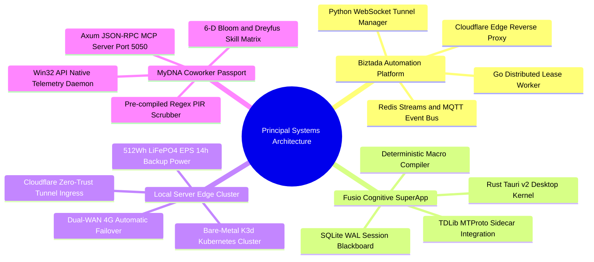

# 👨‍💻 Lead Systems Architect & Principal Contributor Dossier

[🌐 English Edition (Current)](PROFILE.md) | [🇻🇳 Phiên bản Tiếng Việt](https://github.com/DrLucifer1810/system-architecture-case-studies-vi/blob/main/PROFILE.md)

---

## 📌 Executive Summary

I am a **Principal Systems Architect and Staff Distributed Systems Engineer** specializing in high-concurrency distributed backends, bare-metal edge cloud infrastructure, low-level OS systems programming, and autonomous AI-agent runtimes.

With extensive production experience engineering resilient systems under extreme operational constraints (residential NAT traversal, unreliable edge power, zero-trust security perimeters, and sub-millisecond latency budgets), I design architectures that prioritize **correctness, observability, economic sustainability (FinOps), and zero unhandled failure modes**.

This dossier outlines my core architectural philosophies, verified technical competencies, production track record across the 4 case studies in this repository, and scope for professional consulting and advisory engagements.

---

## 📐 Core Engineering Philosophies

### 1. Correctness Over Hype (Zero-Placeholders, Zero-Hallucination)
Software in production does not run on mock data or optimistic assumptions. Every network call will fail; every disk write will encounter contention; every AI model will eventually hallucinate. Systems must be engineered with explicit failure boundaries, deterministic circuit breakers, and comprehensive telemetry.

### 2. Strict Separation of Control Plane and Data Plane
High-throughput payloads (video streams, browser debugging CDP packets, large binary assets) must never share communication channels with latency-critical control signals (distributed heartbeats, lease renewals, task dispatch commands). Decoupling these pathways ensures system responsiveness even under link saturation.

### 3. Edge Sovereignty & Extreme FinOps
Modern cloud computing often masks architectural inefficiency behind exorbitant monthly bills. By architecting self-healing bare-metal edge Kubernetes clusters with on-device caching, local Docker registries, and dual-WAN failover, cloud operational expenditures can be reduced by up to **99.5%** while dramatically improving data sovereignty.

### 4. Client-Side Privacy-First Boundary (Zero-Knowledge Telemetry)
In the generative AI era, telemetry must never become surveillance. All behavioral signals and user context must pass through on-device Privacy Information Redaction (PIR) engines before touching any network interface or external inference pipeline.

---

## 🛠️ Technical Competency Matrix

| Domain | Core Technologies & Tooling | Production Specialization |
| :--- | :--- | :--- |
| **Distributed Systems & Concurrency** | **Go (Golang)**, **Rust**, Goroutines, Tokio Async Runtime, Concurrency Primitives (Mutex, RwLock, Channels) | High-throughput distributed task dispatching, heartbeat lease managers, dead-man switches, lock-free queues. |
| **Messaging & Event Streaming** | **Redis Streams**, **Mosquitto MQTT**, NATS, WebSockets, Server-Sent Events (SSE) | Distributed event choreography, QoS 1 message delivery, fan-out event buses, low-latency RPC gateways. |
| **Edge Infrastructure & K8s** | **Kubernetes (K3s, K3d)**, Docker, Containerd, Private Air-gapped Registries | Bare-metal edge clusters, automated shell bootstrapping, self-healing database state machines, resource limits. |
| **Networking & Zero-Trust** | **Cloudflare Zero Trust Tunnels**, Pages Functions, WireGuard, Tailscale, LibP2P | Portless edge ingress (Zero Open Ports), NAT traversal, dual-WAN 4G automatic failover, reverse proxy tunnels. |
| **Desktop Systems Programming** | **Rust**, **Tauri v2**, Win32 API (`windows-rs`), COM UIAutomation, WebView2 IPC | Native desktop daemons (<30MB RAM), clipboard lineage tracking, URL-fragment hash IPC without headless browsers. |
| **Cognitive AI & Agent Runtimes** | **Model Context Protocol (MCP)**, **Axum**, SQLite WAL, Dreyfus & Bloom Matrices | Localhost JSON-RPC MCP servers, deterministic macro compilation, dynamic state graphs, anti-hallucination AQC. |
| **Databases & State Engines** | **SQLite (WAL)**, **MySQL 8.0**, **MongoDB 6.0**, **Redis 7.0** | Transactional consistency, local blackboards, automated crash-recovery watchdogs, data lineage hashing. |

---

## 🏆 Verified Production Track Record

This repository showcases four end-to-end production architectures that I have personally designed, implemented, and deployed:

### 1. Biztada Distributed Automation Platform
- **Problem:** Coordinating thousands of automated worker processes running on remote residential networks behind dynamic NAT/firewalls without public IPs.
- **Architectural Solution:** Dual-layer control/data separation using Go distributed lease dispatchers, Redis Streams heartbeats with dead-man eviction, and Cloudflare Pages edge reverse proxies.
- **Outcome:** Sub-second task assignment, zero zombie workers, and seamless bidirectional browser control across heterogeneous networks.

### 2. Fusio Cognitive Desktop SuperApp
- **Problem:** Multi-agent LLM systems suffering from infinite hallucination loops, high token latency, and heavy Electron memory footprints.
- **Architectural Solution:** Hybrid Rust (Tauri v2) kernel with a Python 3.11 cognitive daemon, shared SQLite WAL blackboard, and a deterministic macro compilation engine that converts repetitive ReAct loops into instant zero-token scripts.
- **Outcome:** 10,000% speedup on repeated workflows, 100% token cost reduction for compiled macros, and memory consumption under 120MB.

### 3. Local Server Edge Bare-Metal Kubernetes Cluster
- **Problem:** Enterprise cloud managed Kubernetes clusters (AWS EKS / GCP GKE) incurred over $420/month for development and internal workloads, vulnerable to internet outages.
- **Architectural Solution:** 35W TDP Mini PC running K3d/K3s with 10 microservices, local air-gapped Docker registry, portless Cloudflare Zero Trust Tunnels, dual-WAN 4G LTE failover, and a 512Wh LiFePO4 battery providing 14-hour emergency power.
- **Outcome:** Cut monthly infrastructure spend by **99.5%** (~$1.80/month power consumption) with zero open firewall ports and 24/7 continuous uptime.

### 4. MyDNA Decentralized AI-Coworker Passport
- **Problem:** Traditional employee monitoring relies on invasive keyloggers and plain-text screenshots, while static resumes fail to measure real human-AI problem-solving mastery.
- **Architectural Solution:** Non-invasive Win32 API telemetry daemon in Rust, client-side zero-leakage Privacy Information Redaction (PIR) scrubbing >480 MB/s, Myers diff line-level Edit Ratio calculation, and an embedded Axum Model Context Protocol (MCP) server on port 5050.
- **Outcome:** Objective 6-Dimensional competency profiling according to Bloom's Taxonomy and the Dreyfus model, with zero private data transmitted to external LLMs.

---

## 💼 Scope of Engagement & Advisory

I am open to the following professional engagements:
- **Fractional CTO & Principal Systems Architect:** Leading architectural design, system decomposition, and tech stack selection for early-stage and scaling technology ventures.
- **Distributed Systems & Cloud Migration Consulting:** Designing fault-tolerant message buses, edge-to-cloud synchronization, and Kubernetes container orchestrations.
- **FinOps & Edge Infrastructure Auditing:** Auditing cloud infrastructure spend and migrating predictable workloads to resilient, bare-metal edge environments.
- **Agentic AI & MCP Systems Integration:** Building custom Model Context Protocol servers, desktop AI runtimes (Tauri/Rust), and deterministic workflow compilers.

---

## 📬 Contact & Professional Verification

- **GitHub:** [@DrLucifer1810](https://github.com/DrLucifer1810)
- **Repository Portfolio:** [system-architecture-case-studies](https://github.com/DrLucifer1810/system-architecture-case-studies)
- **Direct Discussion:** Available via GitHub Issues / Discussions on this repository for technical inquiries and architectural collaborations.\n
