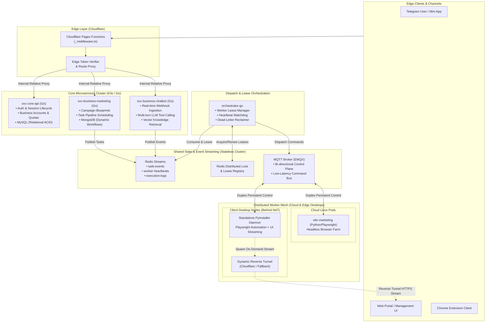

# 🚀 Biztada: Distributed Automation Mesh & Real-time AI CRM

> **Case Study Overview**: Biztada is an enterprise-grade multi-channel marketing automation platform, customer data platform (CDP), and real-time AI CRM. This case study details the engineering architecture developed to reliably coordinate thousands of distributed browser automation workers operating behind corporate firewalls and home NATs.

---

## 📊 High-Level Metrics & Production Scale

- **Fleet Concurrency:** Orchestrates **1,000+** concurrent worker nodes across cloud Linux servers and client desktop machines.
- **Dispatch Latency:** Sub-**50ms** command latency from central core API to edge workers via persistent MQTT.
- **Network Reliability:** **99.9%** reachability for NAT-traversed nodes via autonomous dual-channel fallback (Cloudflare Quick Tunnel + Localtunnel).
- **Execution Integrity:** **Zero duplicate tasks** guaranteed through Redis distributed leases and atomic Pending Entry List (PEL) reclamation.
- **Resource Footprint:** Core Go microservices maintain low memory usage (< **45MB** per pod idle, < **120MB** under peak throughput).

---

## 🏛️ System Architecture Topology

The diagram below illustrates the end-to-end topological boundaries, data flows, and communication channels:

---

## 📑 In-Depth Architecture Breakdown

1. [**System Topology & Microservices (`architecture/01-system-overview.md`)**](./architecture/01-system-overview.md)  
   Comprehensive breakdown of service boundaries, polyglot storage strategies (MySQL + MongoDB + Redis), and internal gRPC/HTTP contracts.

2. [**Dual-Channel Worker Mesh & NAT Traversal (`architecture/02-dual-channel-worker-mesh.md`)**](./architecture/02-dual-channel-worker-mesh.md)  
   How the platform achieves reliable bi-directional communication with worker nodes running on customer desktops behind NAT firewalls without requiring port forwarding or public static IPs.

3. [**Event-Driven Task Orchestration (`architecture/03-event-driven-orchestration.md`)**](./architecture/03-event-driven-orchestration.md)  
   Deep dive into Redis Streams consumer groups, atomic worker lease renewal protocols, and dead-letter queue (DLQ) task recovery mechanisms.

4. [**Edge Security & Zero-Trust Authentication (`architecture/04-edge-security-and-auth.md`)**](./architecture/04-edge-security-and-auth.md)  
   Design of the Cloudflare Pages Functions reverse proxy layer and the Telegram MTProto authentication sidecar.

---

## 🔬 Engineering Bottlenecks & Deep Dives

- [**Bottlenecks & Production Optimizations (`deep-dives/01-bottlenecks-and-optimizations.md`)**](./deep-dives/01-bottlenecks-and-optimizations.md)  
  Analysis of three critical real-world bottlenecks: Chromium browser memory leaks, tunnel provider rate limits, and state drift in multi-node clusters.
- [**Scalability Benchmarks & Resource Profiling (`deep-dives/02-scalability-and-metrics.md`)**](./deep-dives/02-scalability-and-metrics.md)  
  Throughput measurements, memory profiling across Go vs Python services, and connection scaling curves.
- [**DevOps, Packaging & Observability (`deep-dives/03-devops-and-packaging.md`)**](./deep-dives/03-devops-and-packaging.md)  
  Packaging Python and Playwright browser binaries into zero-dependency client bundles using PyInstaller, K3s Kubernetes orchestration, and structured logging.

---

## 💻 Sanitized Code Samples

Functional, runnable reference implementations demonstrating the design patterns in this case study:

- [`sanitized-code/go-worker-lease-dispatcher/`](./sanitized-code/go-worker-lease-dispatcher/): Go implementation of a Redis Streams consumer with atomic distributed lease allocation and graceful context cancellation.
- [`sanitized-code/python-resilient-tunnel-manager/`](./sanilient-code/python-resilient-tunnel-manager/): Python implementation of dynamic reverse tunnel management with automatic health probes and multi-provider fallback.
- [`sanitized-code/edge-api-gateway/`](./sanitized-code/edge-api-gateway/): TypeScript Cloudflare Pages Functions reverse proxy middleware with edge authentication and path canonicalization.
