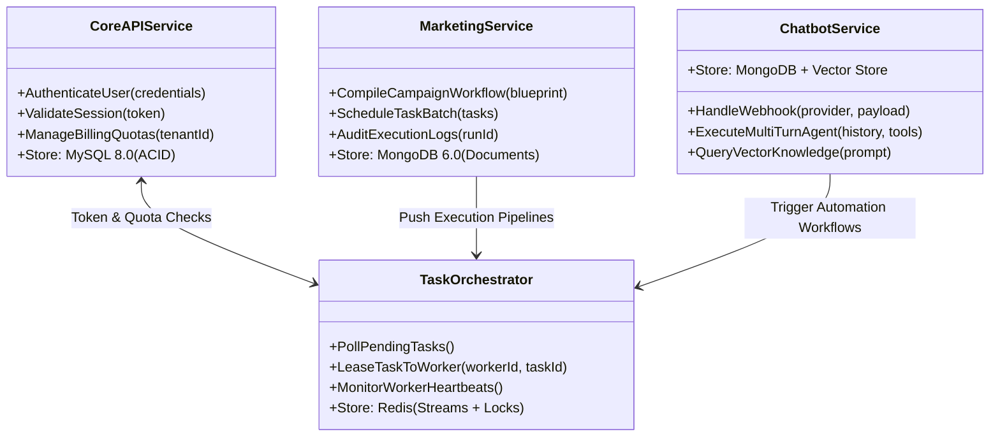
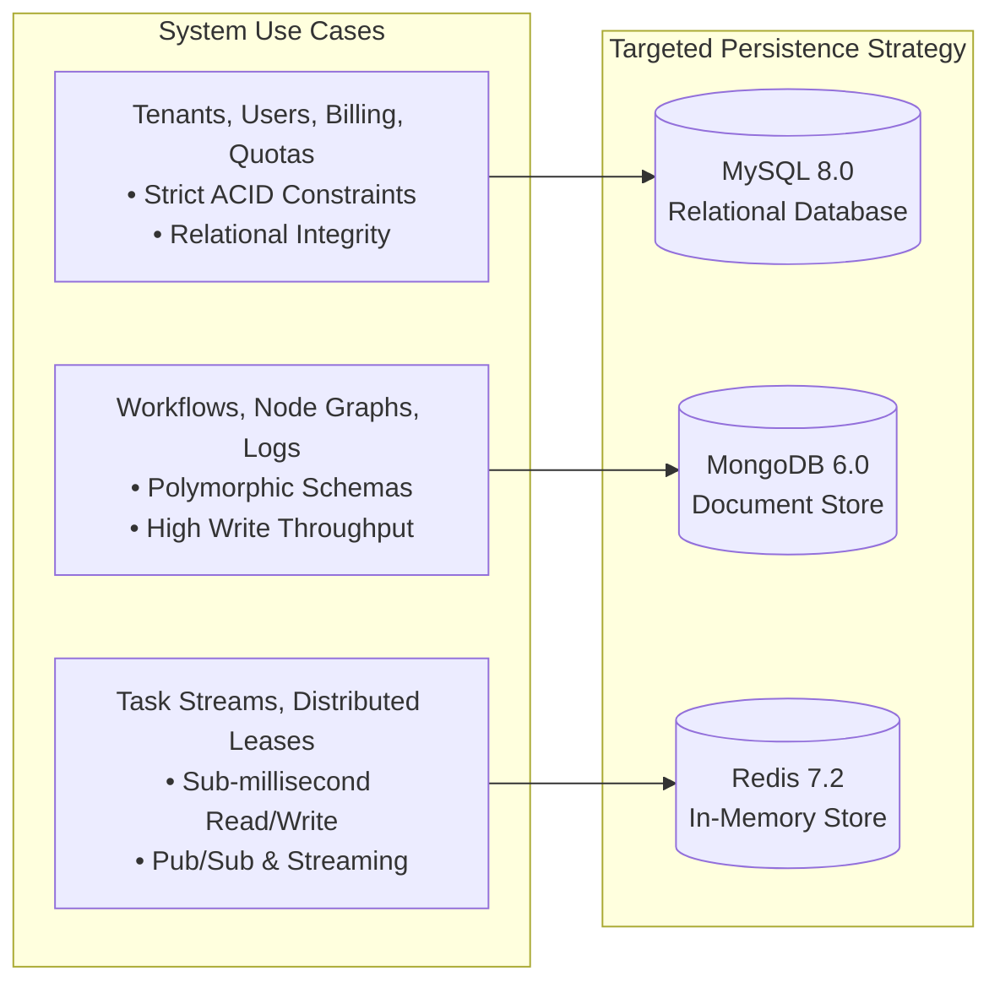
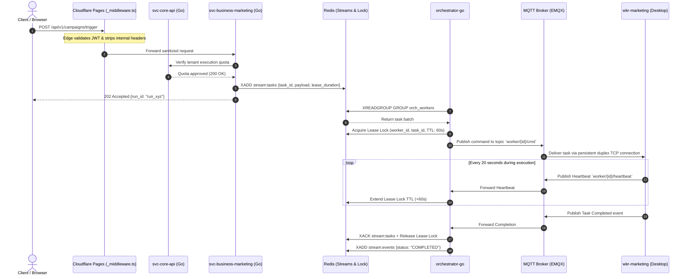

# 🏛️ Architecture: System Overview & Topology

## 1. Domain Decomposition & Service Boundaries

The platform is designed around domain-driven microservices implemented primarily in **Go (Golang)** to maximize concurrency, minimize latency, and keep server resource footprints minimal.

### Microservice Directory & Roles:

| Service Name | Primary Language | Storage Engine | Responsibility |
| :--- | :--- | :--- | :--- |
| **`svc-core-api`** | Go 1.22 | **MySQL 8.0** | Master identity, RBAC, tenant organization hierarchy, subscription/billing quotas, and token revocation tables. |
| **`svc-business-marketing`** | Go 1.22 | **MongoDB 6.0** | Flexible schema storage for marketing campaigns, dynamic node workflows, automation templates, and audit logs. |
| **`svc-business-chatbot`** | Go 1.22 | **MongoDB + Redis** | High-throughput multi-channel webhook ingestion (Facebook Messenger, Telegram Bot API), LLM tool execution, RAG embeddings. |
| **`orchestrator-go`** | Go 1.22 | **Redis (In-Memory)** | Stateless worker fleet manager, task lease allocation, heartbeat watchdog, and dead-letter queue reclaimer. |
| **`wkr-marketing`** | Python 3.11 | Local SQLite / Mem | Autonomous execution agent using Playwright browser engine, proxy routing, and local anti-detect fingerprinting. |

---

## 2. Polyglot Storage Strategy

A single database paradigm cannot simultaneously support ACID financial transactions, flexible nested workflow graphs, and microsecond-latency task coordination. The platform uses a targeted **Polyglot Persistence Model**:

### Why Redis Streams Instead of Heavy Message Brokers (Kafka/RabbitMQ)?
1. **Lightweight Operational Overhead:** The infrastructure operates in resource-constrained environments (K3s edge clusters) where running a dedicated Kafka JVM cluster with ZooKeeper/KRaft would consume multiple gigabytes of memory just for idle state.
2. **Consumer Group Primitives:** Redis Streams natively provides consumer groups, automatic message tracking via Pending Entries Lists (PEL), and atomic acknowledgement (`XACK`), matching Kafka’s core semantic capabilities at a fraction of the RAM cost.
3. **Unified Cache & Broker:** Leveraging Redis for both distributed locking (`SET NX EX`) and streaming queues eliminated the complexity of cross-service two-phase commits.

---

## 3. Request Lifecycle: End-to-End Sequence

