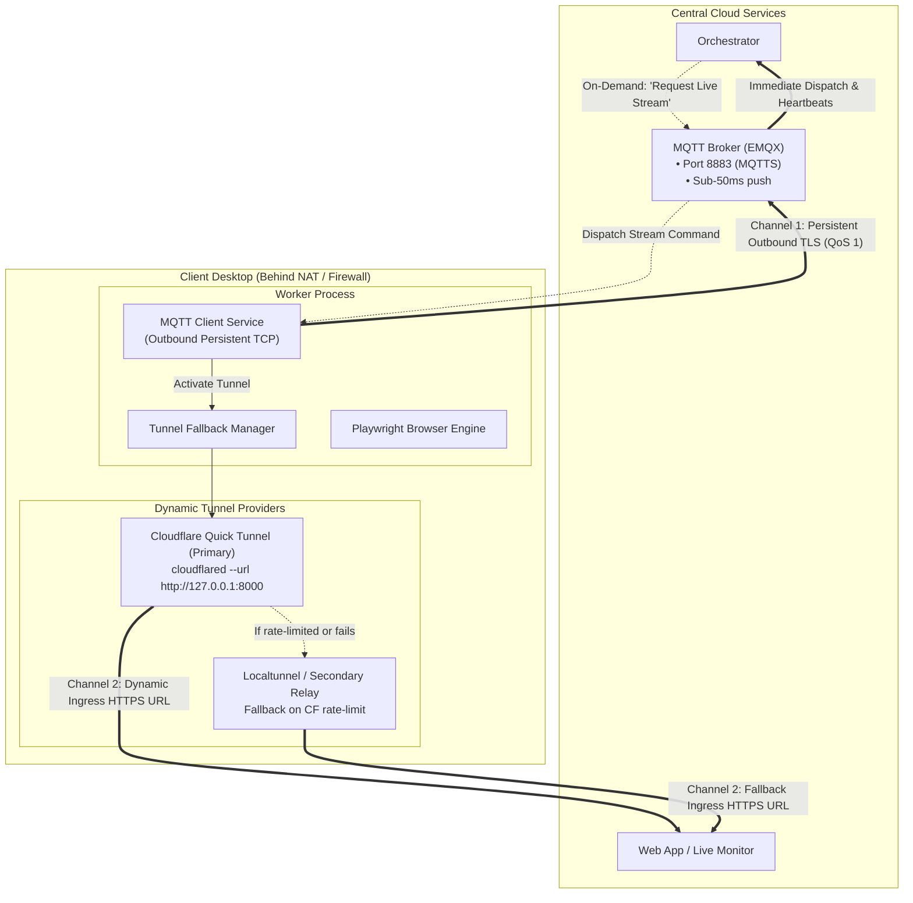
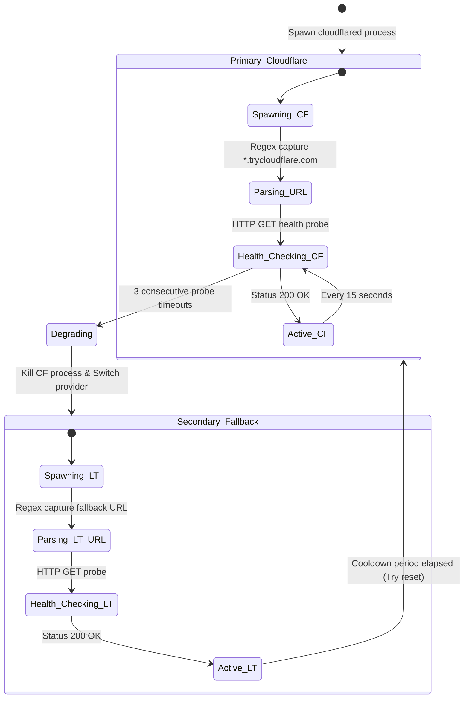

# 🌐 Architecture: Dual-Channel Worker Mesh & NAT Traversal

## 1. The Production Challenge: NAT & Dynamic Firewalls

A major subset of automation workers in Biztada run as native desktop applications on client computers (Windows and Linux machines) rather than inside dedicated cloud data centers. This presents severe networking hurdles:

1. **Carrier-Grade NAT (CGNAT):** Client machines do not have public IP addresses. Inbound connections from the cloud backend are blocked by local firewalls and ISP routing policies.
2. **Dynamic Client IP Changes:** Residential internet connections frequently reassign IP addresses or experience temporary disconnections.
3. **No Port-Forwarding:** Expecting enterprise end-users to configure router port forwarding or UPnP is an operational impossibility.
4. **Bandwidth Asymmetry:** Continuous high-bandwidth video/browser streaming over persistent tunnels would rapidly hit cloud provider rate limits or saturate consumer upload bandwidth.

---

## 2. The Solution: Dual-Channel Control & Data Plane Separation

To resolve this, we separated the network interaction into two distinct channels with decoupled responsibilities:



---

## 3. Channel Breakdown & Specifications

### Channel 1: Control Plane (Persistent MQTT)
- **Protocol:** MQTT 5.0 over TLS (TCP Port 8883) with WebSockets fallback.
- **Traffic Profile:** Extremely lightweight (heartbeat payload is ~128 bytes every 20 seconds).
- **Behavior:**
  - The worker initiates an **outbound** connection to the cloud MQTT broker upon startup. Outbound traffic is universally permitted by residential routers.
  - Commands from the orchestrator are dispatched directly to the topic `workers/{worker_id}/commands` with **QoS 1** (at-least-once delivery with broker ACK).
  - Even if the worker machine changes local Wi-Fi or cellular networks, the MQTT client automatically reconnects with exponential backoff and re-subscribes without losing state.

### Channel 2: Data Plane (On-Demand Dynamic Reverse Tunnel)
- **Primary Provider:** Cloudflare Quick Tunnel (`cloudflared`).
- **Secondary Provider:** Localtunnel / SSH reverse relay fallback.
- **Traffic Profile:** High-bandwidth HTTP / WebSocket (streaming live Chromium viewport via CDP or WebRTC).
- **On-Demand Activation:**
  - Under normal autonomous task execution, the tunnel is **dormant** (saving memory and avoiding ISP/Cloudflare rate limits).
  - When an operator opens the web dashboard to inspect an active browser session, a control packet is sent via Channel 1.
  - The worker spawns `cloudflared` locally, captures the generated ephemeral public URL (`https://*.trycloudflare.com`), and publishes an updated registration message via Channel 1 back to the orchestrator.

---

## 4. Multi-Provider Fallback State Machine

Network tunnels can fail due to provider rate limiting (e.g. Cloudflare Quick Tunnel DNS propagation glitches or IP quotas). The worker incorporates an autonomous health watchdog:



### Invariant Guarantee:
Regardless of which dynamic tunnel provider is active, the registration payload reported to the backend orchestrator maintains identical schema:
```json
{
  "worker_id": "wkr_win_883a91",
  "status": "online",
  "active_tunnel_url": "https://random-subdomain.trycloudflare.com",
  "tunnel_provider": "cloudflare",
  "timestamp": 1728810450
}
```
This abstraction ensures the central core and web UI remain completely decoupled from underlying tunnel infrastructure.
