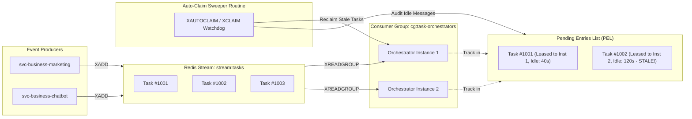
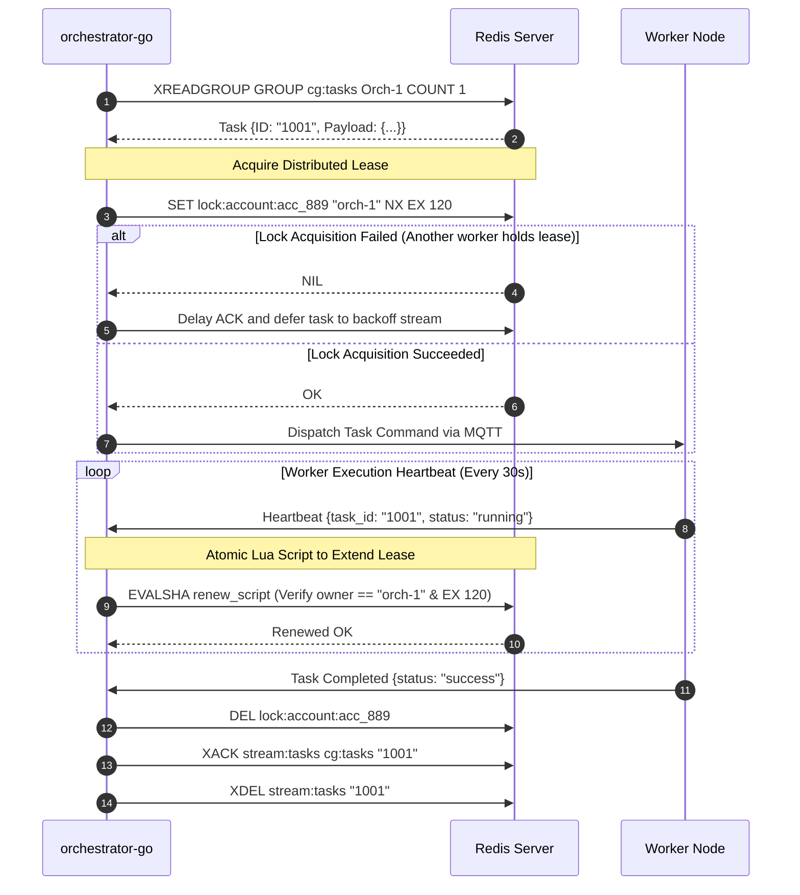

# ⚡ Architecture: Event-Driven Task Orchestration & Distributed Leases

## 1. Overview of Task Scheduling Architecture

Long-running automation tasks (such as crawling multiple dynamic pages or batch-messaging verified prospects) introduce unique challenges that traditional synchronous REST endpoints cannot address:
- Tasks may run for minutes or hours.
- Workers can suddenly lose connectivity, encounter hardware reboots, or exhaust memory.
- If a task fails midway, it must either be safely retried without duplicate execution of completed side-effects, or sent to an administrative Dead-Letter Queue (DLQ).

The platform implements an **Event-Driven Task Orchestrator** in Go powered by **Redis Streams** and **Atomic Distributed Leases**.

---

## 2. Redis Streams Topology & Consumer Groups



---

## 3. The Distributed Worker Lease Protocol

To prevent multiple workers from executing the same campaign or account simultaneously (which could result in anti-spam security bans by third-party platforms), every task execution requires a **Distributed Lease**:



### Atomic Lease Renewal Lua Script:
To guarantee that a slow worker whose lease has already expired does not inadvertently extend or delete a lease newly acquired by another worker, lease renewal and release use Lua scripts:

```lua
-- Atomic Lease Renewal Script
if redis.call("get", KEYS[1]) == ARGV[1] then
    return redis.call("expire", KEYS[1], ARGV[2])
else
    return 0
end
```

---

## 4. Crash Recovery & Dead-Letter Queue (DLQ)

If an orchestrator or worker process crashes abruptly:
1. The message remains unacknowledged in the **Pending Entries List (PEL)**.
2. A background sweeper routine executes `XPENDING stream:tasks cg:tasks` every 30 seconds.
3. Any message that has been idle for more than `2 * Heartbeat_Interval` (e.g. > 60 seconds) is reclaimed using `XAUTOCLAIM`.
4. If a task’s delivery counter exceeds the maximum retry threshold (`retry_count >= 3`), the sweeper removes it from `stream:tasks`, writes it to `stream:tasks:dlq`, and emits an alert to the administrative dashboard.
