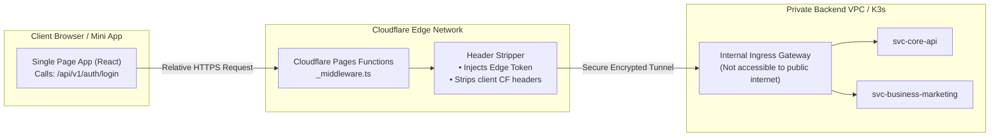
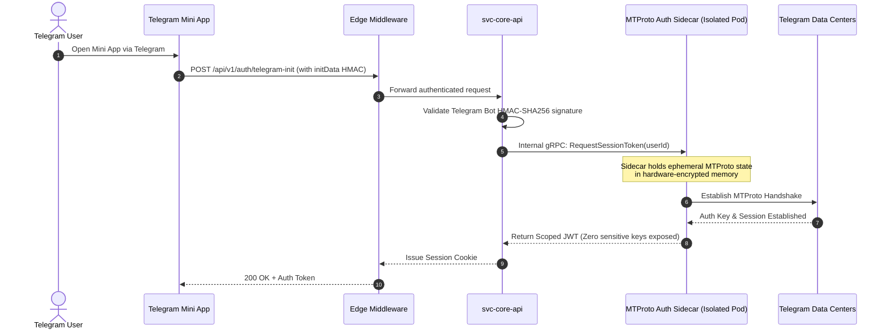

# 🛡️ Architecture: Edge Security & Zero-Trust Authentication

## 1. Zero-Trust Edge Routing via Cloudflare Pages Functions

In modern cloud architecture, directly exposing backend API domains (e.g. `https://api.business.internal`) to browser clients introduces significant security vulnerabilities:
- **DNS/IP Exposure:** Attackers can bypass CDN protections and launch direct Distributed Denial of Service (DDoS) attacks against origin load balancers.
- **Cross-Origin Resource Sharing (CORS) Overhead:** Complex pre-flight `OPTIONS` requests introduce latency and fragile browser header configurations.
- **Credential Leakage in Client Code:** Embedding absolute backend endpoints or static staging secrets in front-end JavaScript bundles invites reverse engineering.

### The Architectural Rule: Relative Edge Proxying
All frontend applications (including the React web platform and Telegram Mini Apps) strictly communicate using **relative paths** (`/api/v1/...`). 

Traffic is mediated at the edge by **Cloudflare Pages Functions Middleware** (`functions/_middleware.ts`):

### Edge Middleware Functions:
1. **Dynamic Path Canonicalization:** Translates public route segments (e.g., `/api/v1/marketing/*`) into dedicated internal cluster service ports without requiring multiple public domain names.
2. **Hop-by-Hop Header Stripping:** Cleans incoming HTTP headers to prevent header smuggling and spoofing.
3. **CORS Elimination:** Since frontend assets and `/api/*` endpoints share the identical origin domain, zero CORS preflight overhead is incurred.

---

## 2. Zero-Trust Telegram MTProto Authentication Sidecar

For automation involving Telegram account sessions (such as enterprise community CRM bots), managing Telegram's native binary **MTProto protocol** within standard web microservices is anti-pattern:
- The MTProto binary protocol maintains persistent state and encryption keys that do not align with stateless REST architecture.
- Storing decrypted session keys in the primary database presents catastrophic security risks if the database is ever compromised.

### The MTProto Sidecar Architecture:

### Security Isolation Properties:
- **Stateless Web Services:** Core Go microservices handle standard JSON REST traffic without managing stateful MTProto socket connections.
- **Air-Gapped Key Storage:** The Sidecar runs in an isolated network namespace. Session encryption keys are stored solely in ephemeral memory and discarded immediately upon session logout.
