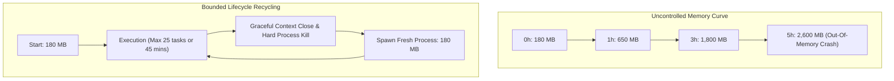
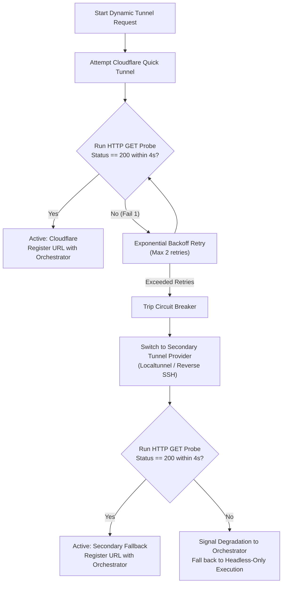

# 🔬 Deep Dive: Production Bottlenecks & Architectural Optimizations

Operating a large distributed automation fleet reveals failure modes that rarely appear in traditional CRUD microservices. Below are three major production bottlenecks encountered during the development of Biztada and the architectural optimizations engineered to solve them.

---

## Bottleneck 1: Chromium / Playwright Memory Bloat & Zombie Processes

### The Failure Mode
Chromium is engineered as an interactive consumer browser, not a 24/7 background automation daemon. When Playwright drives Chromium through hundreds of dynamic Single Page Applications (SPAs):
- V8 JavaScript heaps, internal layout caches, and GPU buffers accumulate memory.
- A single browser instance that starts at **180MB RAM** routinely swells to **2.2GB+ RAM** within 3–4 hours of continuous execution.
- If a script encounters an unhandled rejection, headless processes occasionally detach and turn into **Zombie Chromium processes**, consuming CPU and RAM indefinitely until the host OS exhausts swap and crashes.

### The Architectural Optimization: Finite-Life Worker Pool Pattern
1. **Isolated Context Sandboxing:** Instead of running automation in the default browser context, every discrete task spawns an ephemeral `BrowserContext` with dedicated cookie storage and cache partitions, immediately disposed via `await context.close()`.
2. **Deterministic Process Recycling:** The worker daemon enforces a strict task ceiling (`MAX_TASKS_PER_PROCESS = 25`). Upon reaching the limit, the worker signals the orchestrator that it is entering maintenance mode, finishes in-flight requests, gracefully shuts down Chromium, runs an OS-level PID check to terminate any dangling child processes (`kill_process_tree`), and spawns a fresh browser instance.
3. **Outcome:** Average worker memory consumption stabilized at **220MB ± 40MB** consistently over 30+ days of uninterrupted uptime.

---

## Bottleneck 2: Ingress Flakiness & Cloudflare Quick Tunnel Rate Limits

### The Failure Mode
To allow operators to remotely view live automated browser sessions on client desktop machines without opening router ports, workers generate dynamic reverse tunnels using `cloudflared`. 
However, Cloudflare Quick Tunnel is a shared public infrastructure subject to:
- Random DNS propagation delays (new subdomains taking 5–15 seconds to resolve globally).
- Subdomain collision rate limits during burst worker reconnects (e.g. following an ISP network reset).
- Intermittent HTTP 530 / 1033 edge routing errors.

### The Architectural Optimization: Autonomous Multi-Provider Circuit Breaker
Instead of tightly coupling the worker to Cloudflare, the networking layer was abstracted into an **Autonomous Tunnel Fallback Engine**:

### Key Technical Details:
- **Active Probing Before Registration:** The worker never advertises a new tunnel URL to the central orchestrator until its internal watchdog has successfully performed an external HTTP `GET /health` roundtrip against that public URL.
- **Graceful Control Plane Fallback:** If all visual tunnel providers are temporarily blocked, the worker does not crash. It simply falls back to **Headless-Only Execution** over Channel 1 (MQTT), continuing automation without disruption to the underlying business workflow.

---

## Bottleneck 3: Distributed State Drift Under Abrupt Disconnections

### The Failure Mode
In client-side automation, user computers can abruptly go to sleep (laptop lid closed), experience Wi-Fi drops, or be powered off. 
- In naive systems, database records remain flagged as `status: "IN_PROGRESS"`.
- Associated social media accounts remain "locked" by the defunct task, preventing scheduled marketing posts from ever executing.

### The Architectural Optimization: Two-Tier Heartbeat & Redis Lease Sweep
We decoupled task state from direct database records during execution:
1. **In-Flight State is Ephemeral:** When a task begins, its active lease is recorded exclusively in Redis (`SET lock:task:{id} {worker_id} EX 60`).
2. **Continuous Pulse:** The worker transmits a 128-byte MQTT heartbeat packet every 20 seconds.
3. **Lease Extension via Lua:** The orchestrator verifies lock ownership and refreshes the Redis expiration to 60 seconds.
4. **Autonomous Sweeper:** If a worker machine shuts down, no heartbeat arrives. Exactly 60 seconds later, the Redis key automatically expires. An orchestrator background goroutine detects the expired lease, re-queues the task in Redis Streams with an incremented attempt counter, and updates the permanent MongoDB log to `RETRYING_AFTER_WORKER_TIMEOUT`.

This guaranteed **zero stranded tasks** and eliminated manual database interventions.
