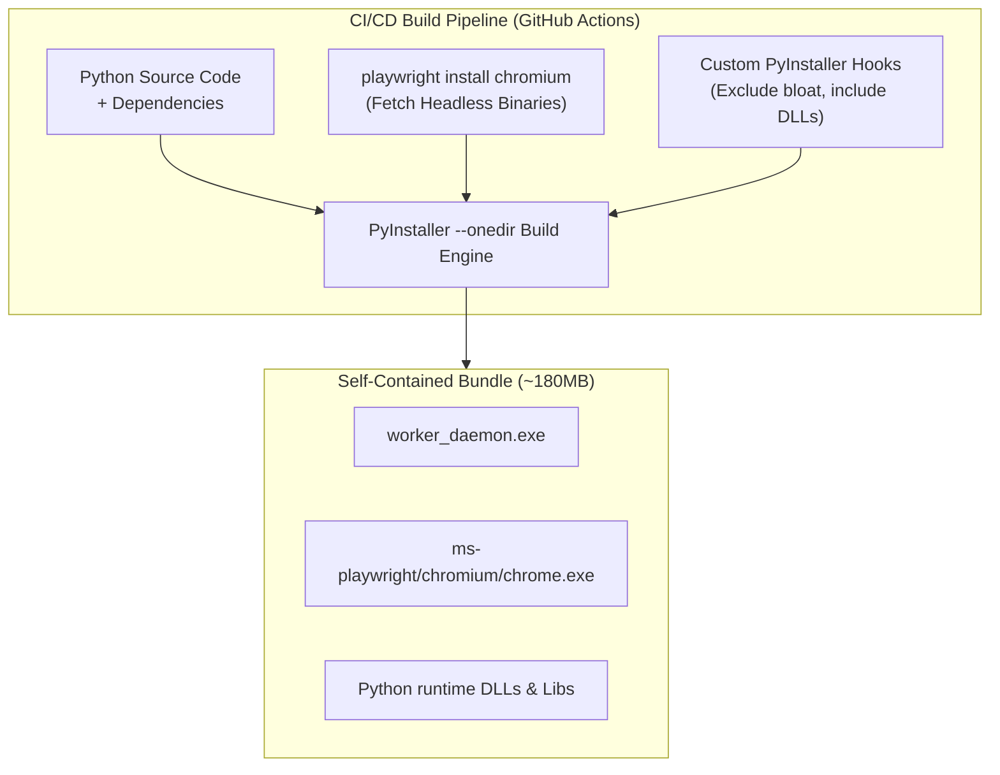
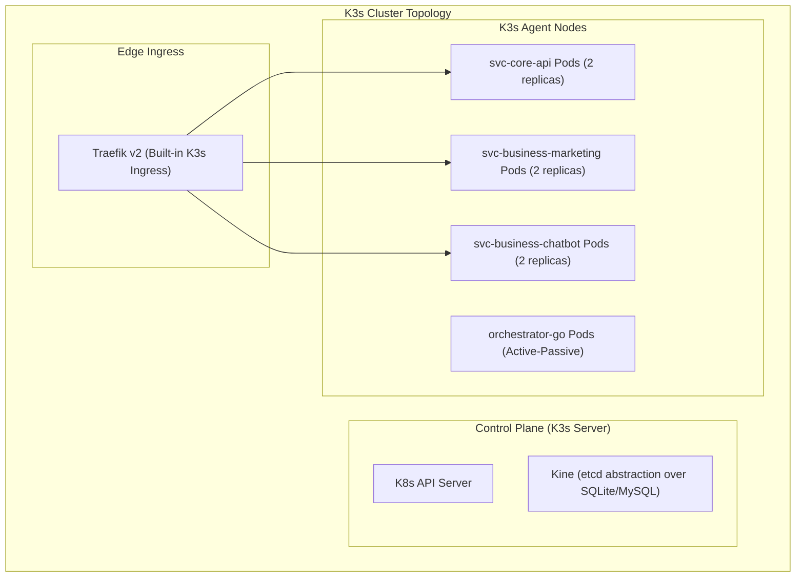

# 🚀 Deep Dive: DevOps, Standalone Packaging & Observability

Delivering complex distributed systems to non-technical end users while managing cloud microservices requires seamless packaging and automated operations. This document outlines the DevOps and packaging pipelines built for Biztada.

---

## 1. Zero-Dependency Desktop Packaging: PyInstaller + Playwright

### The Challenge:
Distributing Python automation scripts to client desktops typically involves:
1. Installing Python 3.11+.
2. Running `pip install -r requirements.txt`.
3. Installing Node.js and running `playwright install chromium` to fetch 150MB+ browser binaries.
4. Setting up system environment variables.

For business end users, this multi-step installation causes a **90%+ drop-off rate** due to permission errors, missing Visual C++ redistributables, or terminal confusion.

### The Solution: Self-Contained Binary Bundling
We developed a specialized PyInstaller packaging pipeline that compiles Python, dependencies, and Chromium into a portable single-directory application:



### Key Technical Innovations in the Spec File:
1. **Dynamic Driver Path Injection:** Playwright locates browsers via `PLAYWRIGHT_BROWSERS_PATH`. The bundle injects an override upon startup:
   ```python
   if getattr(sys, 'frozen', False):
       base_path = sys._MEIPASS if hasattr(sys, '_MEIPASS') else os.path.dirname(sys.executable)
       os.environ["PLAYWRIGHT_BROWSERS_PATH"] = os.path.join(base_path, "ms-playwright")
   ```
2. **Exclusion of Redundant Test Frameworks:** Excluded non-runtime libraries (`unittest`, `doctest`, `idlelib`, etc.) reducing bundle footprint by **42MB**.
3. **Automated Code Signing:** The compiled binary is signed with an EV Code Signing Certificate during GitHub Actions release workflows, avoiding Windows SmartScreen security alerts.

---

## 2. Cloud Orchestration: Lightweight K3s Architecture

For the cloud infrastructure, standard managed Kubernetes (EKS/GKE) introduces unnecessary cost and control plane latency for medium-tier cluster sizes. We selected **K3s** (Lightweight Kubernetes by Rancher):



### High-Availability Probes:
All Go microservices implement standardized non-blocking health endpoints:
```yaml
livenessProbe:
  httpGet:
    path: /healthz
    port: 8080
  initialDelaySeconds: 5
  periodSeconds: 10
  failureThreshold: 3
readinessProbe:
  httpGet:
    path: /readyz
    port: 8080
  initialDelaySeconds: 3
  periodSeconds: 5
```
- `/healthz`: Verifies whether the HTTP server process is running and not deadlocked.
- `/readyz`: Verifies active connectivity to downstream databases (MySQL ping, Redis ping). If Redis becomes temporarily unreachable, traffic is immediately rerouted without terminating the pod.

---

## 3. Distributed Observability & Correlation Tracing

To trace a business action across the entire distributed boundary:

```
[Web User Click] 
      │ (X-Correlation-ID: req_9f3b12)
      ▼
[Cloudflare Edge Middleware]
      │ Injects correlation ID into headers
      ▼
[svc-business-marketing]
      │ Writes task event to Redis Streams with correlation_id
      ▼
[orchestrator-go]
      │ Dispatches command via MQTT topic with correlation_id
      ▼
[Client Desktop Worker]
      │ Emits JSON logs tagged with correlation_id
```

Every service formats logs using **JSON Structured Logging**:
```json
{
  "timestamp": "2026-10-13T09:15:00.124Z",
  "level": "INFO",
  "service": "orchestrator-go",
  "correlation_id": "req_9f3b12",
  "worker_id": "wkr_win_883a91",
  "task_id": "tsk_1001",
  "event": "lease_extended",
  "remaining_ttl_sec": 60
}
```
This enables unified log aggregation and tracing across both cloud microservices and distributed desktop workers.
