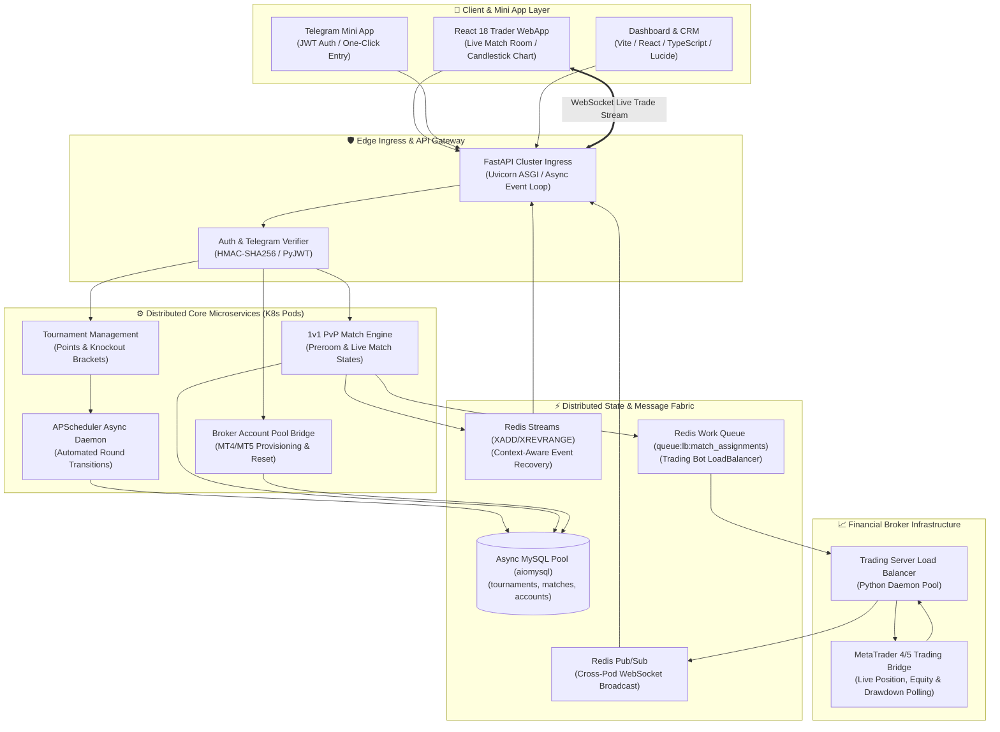

# ⚔️ F2F Trading Arena: Real-Time Financial Trading Tournament & PvP Engine

[](https://github.com/DrLucifer1810/system-architecture-case-studies)
[](https://fastapi.tiangolo.com/)
[](https://redis.io/)
[](https://kubernetes.io/)
[](LICENSE)

[🇻🇳 Phiên bản Tiếng Việt có sẵn tại: system-architecture-case-studies-vi](https://github.com/DrLucifer1810/system-architecture-case-studies-vi/tree/main/projects/f2f-trading-tournament-engine)

---

## 📌 Executive Summary

**F2F Arena (Face-to-Face Trading Arena)** is a high-concurrency, event-driven distributed platform engineered for **real-time PvP financial trading tournaments and head-to-head trading battles**. 

Connecting directly with broker trading servers (MetaTrader MT4/MT5 and institutional liquidity bridges), F2F Arena orchestrates live competitive trading environments where participants trade on synchronized demo accounts with strict bracket rules, automated round transitions, real-time PnL/Equity tracking, and instantaneous WebSocket leaderboard broadcasting across multi-pod Kubernetes clusters.

Unlike standard e-sports platforms, financial trading tournaments introduce extreme non-functional demands:
- **Broker Account Pooling & Credential Isolation:** Sub-second checkout and provisioning of MetaTrader credentials to matched traders with automated balance resets.
- **Zero-Loss State Synchronization:** Trader mobile apps (including Telegram Mini Apps) frequently drop connections during live matches; an on-device Redis Streams event recovery pipeline replays missed trade events upon reconnect.
- **Fair Round Scheduling:** Deterministic bracket progression (Points stage into Knockout elimination) calculated dynamically across UTC time boundaries without manual admin intervention.

---

## 🏛️ High-Level System Architecture



---

## 📁 Architectural Blueprint Index

```text
projects/f2f-trading-tournament-engine/
├── README.md                                 # Executive Blueprint & Overview (Current)
├── architecture/
│   ├── 01-system-overview.md                 # High-throughput asynchronous topology & K8s pod cluster
│   ├── 02-distributed-matchmaking-engine.md  # Points stage, Knockout elimination & bracket generation
│   ├── 03-broker-account-pool-bridge.md      # MetaTrader account pooling, load balancer queue & reset
│   └── 04-realtime-websocket-event-recovery.md# Multi-pod WebSocket pub/sub & Redis Streams zero-loss replay
├── deep-dives/
│   ├── 01-round-timing-and-bracket-fairness.md# Deterministic round scheduling & tie-breaking formulas
│   ├── 02-multi-pod-redis-stream-recovery.md # Context-aware event replay on reconnect (XADD/XREVRANGE)
│   └── 03-trading-loadbalancer-dispatch.md   # Asynchronous trading server bots & credential isolation
└── sanitized-code/
    ├── fastapi-match-event-recovery/         # Runnable Python async Redis stream recovery module
    ├── go-bracket-matchmaker/                # Compilable Go tournament bracket generator with unit tests
    └── broker-account-pool-dispatcher/       # Runnable Python broker account queue dispatcher with tests
```

---

## ⚡ Production Performance & Reliability SLA

| Operational Dimension | Target SLA / Measured Metric | Architectural Design Choice |
| :--- | :--- | :--- |
| **Match Assignment Latency** | `< 250 ms` | Asynchronous Redis queue push (`queue:lb:match_assignments`) |
| **Live PnL Broadcast Frequency** | `1000 ms per tick` | Redis Pub/Sub multiplexed into WebSocket ASGI channels |
| **Reconnect Event Recovery** | `< 15 ms replay latency` | Context-bounded Redis Streams (`XREVRANGE` capped at 100 entries) |
| **Account Pool Allocation** | `O(1) Atomic Checkout` | MySQL transactional lock with account state machine |
| **Cluster Pod Scalability** | Horizontal K8s Pods | Stateless FastAPI instances tracked via `POD_ID = os.getenv("HOSTNAME")` |
| **Tournament State Failover** | Zero Tournament Loss | Persistent MySQL storage with APScheduler self-healing loop |
