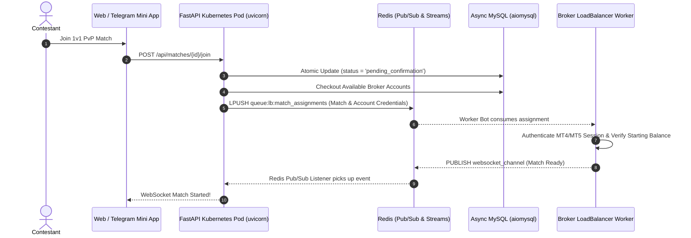

# 📐 Architectural Specification 01: High-Throughput Asynchronous Topology & Pod Cluster

## 1. Domain Requirements & Operational Realities

Financial trading tournaments present extreme latency, integrity, and concurrency challenges:
- **Synchronous Execution Hazards:** Querying broker APIs (MetaTrader Manager / REST bridges) synchronously inside web handlers introduces 2–5 second blocking delays, starving ASGI event loops.
- **Multi-Pod Real-Time Broadcasting:** When thousands of concurrent traders observe a tournament match, connections are distributed across multiple Kubernetes pods. An event produced on Pod A must reach clients connected to Pod B without delay.
- **Strict Data Consistency:** Financial prizes and rankings require absolute transactional integrity: balance calculations, equity drawdowns, and trade records must be immune to double-spend and race conditions.



---

## 2. Stateless Kubernetes Pod Topology (`main.py`)

Each FastAPI pod operates as an identical, stateless worker coordinated through distributed primitives:

```python
# Multi-Pod Identification in Kubernetes
POD_ID = os.getenv("HOSTNAME", f"pod-{os.getpid()}")
logging.info(f"🆔 Active Kubernetes Pod ID: {POD_ID}")

# Async MySQL Connection Pool Singleton
pool = await get_pool()

# Global Redis Client & Pub/Sub Daemon
redis_client = redis.from_url(REDIS_URL, decode_responses=True)
redis_pubsub = redis_client.pubsub()
await redis_pubsub.subscribe("websocket_channel")
```

### Pod Lifecycle & Event Recovery Initialization
Upon startup, the FastAPI lifespan context manager initializes:
1. **The `aiomysql` Connection Pool:** Pre-allocates async MySQL connections with reconnect hooks.
2. **The Redis Pub/Sub Subscriber:** Spawns a background Tokio/Asyncio task listening to `websocket_channel`.
3. **The `EventRecovery` Daemon:** Registers stream serialization policies to persist critical match transitions.
4. **The `APScheduler` Instance:** Runs scheduled jobs (checking upcoming tournaments, round time expirations, and deposit/withdrawal checks).

---

## 3. Modular Clean Architecture Layering

The codebase is organized into cleanly decoupled layers:
- **`tournament_management.py`:** Complete lifecycle for multi-player tournaments (points group phase, knockout elimination brackets, registration windows, and prize distributions).
- **`match_management.py`:** Manages 1v1 PvP matches (room creation, invite codes, pre-room confirmations, live countdowns, and settlement).
- **`trading_server_management.py`:** Bridges matches with trading servers, formats credentials, and pushes jobs to the broker queue.
- **`broker_management.py`:** Manages broker entities, server addresses, demo balance thresholds, and account pools.
- **`event_recovery.py`:** Context-based Redis Streams event recovery preventing data loss upon network drops.
- **`telegram_bot.py`:** Telegram Bot API notifications, authentication verification, and administrative alerts.
