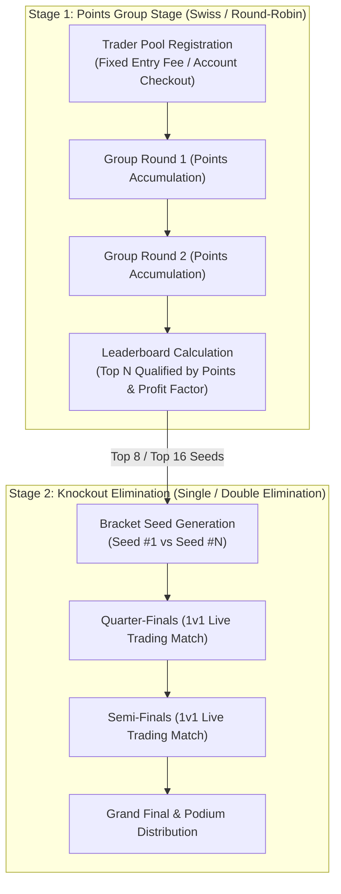

# 📐 Architectural Specification 02: Distributed Matchmaking & Tournament Engine

## 1. Multi-Stage Tournament Progression Mechanics

F2F Arena supports a hybrid two-stage tournament progression model designed to maximize trader engagement and competitive fairness:



---

## 2. Automated Tournament State Machine (`tournament_management.py`)

Tournaments transition through a deterministic lifecycle without human supervisor intervention:

$$\text{Upcoming} \xrightarrow{\text{event\_time} \le \text{now}} \text{Live (Round 1)} \xrightarrow{\Delta t_{\text{round}}} \text{Round Transition} \xrightarrow{\text{Final Round}} \text{Completed}$$

```python
async def check_and_start_tournaments():
    \"\"\"
    Scans the database for tournaments that have reached their scheduled start time,
    automatically generates round 1 pairings, and assigns demo trading accounts.
    \"\"\"
    pool = await get_pool()
    async with pool.acquire() as conn:
        async with conn.cursor(DictCursor) as cursor:
            query = \"\"\"
                SELECT id, event_time, status, total_rounds, total_round_duration_minutes 
                FROM tournament_info 
                WHERE status = 'upcoming' AND event_time <= UTC_TIMESTAMP()
            \"\"\"
            await cursor.execute(query)
            tournaments = await cursor.fetchall()
            
            for t in tournaments:
                await start_tournament_round_one(cursor, t["id"])
```

---

## 3. Bracket Generation & Pairing Logic

For knockout rounds, contestant pairings are generated using standard tournament seeding algorithms:
- Seed $i$ is paired with Seed $(N - i + 1)$ to ensure that the highest-ranked contestants do not eliminate each other in preliminary rounds.
- Ties in score are broken deterministically by:
  1. **Total Profit / ROI Percentage:** $\frac{\text{Ending Equity} - \text{Starting Balance}}{\text{Starting Balance}} \times 100\%$
  2. **Maximum Drawdown ($\text{MDD}$):** Lowest peak-to-trough decline wins.
  3. **Total Traded Volume:** Highest lot volume executed during the round.
