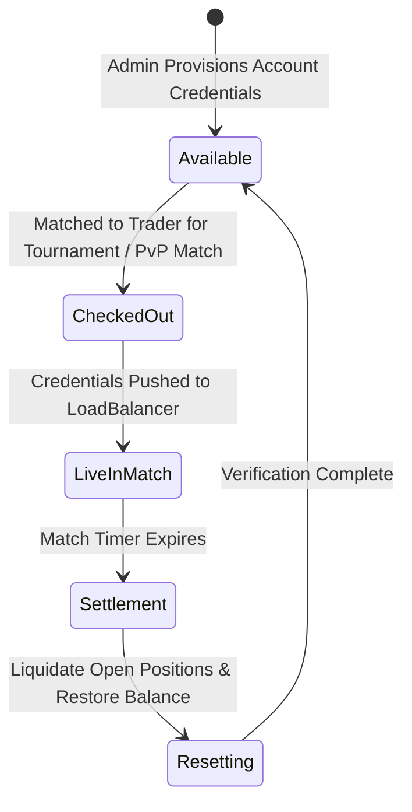

# 📐 Architectural Specification 03: Broker Trading Server Bridge & Account Pool

## 1. The Challenge of Broker Account Management

Connecting live traders to financial brokers (MetaTrader 4, MetaTrader 5, cTrader) imposes strict physical and protocol boundaries:
- **Creating MT4/MT5 accounts on the fly takes 3–10 seconds** via broker APIs, which is far too slow for real-time matchmaking.
- **Credentials must remain confidential:** Contestant passwords must never be exposed to other players or stored in insecure client caches.
- **Account Recycling:** After a match terminates, the account must be reset (positions closed, balance restored, password rotated) before being placed back into the pool.

---

## 2. The Account Pool State Machine (`account_management.py`)

F2F Arena maintains a pre-provisioned pool of broker accounts categorized by state:



---

## 3. Load Balancer Asynchronous Work Queue (`trading_server_management.py`)

When a match is confirmed, the server extracts broker credentials and dispatches a JSON work payload to the Redis queue `queue:lb:match_assignments`:

```python
async def push_match_to_loadbalancer(cursor, match_id: int, match_type: str = "tournament"):
    \"\"\"
    Pushes match assignment to LoadBalancer queue via Redis.
    Guarantees credential delivery to external broker monitoring daemons.
    \"\"\"
    payload = {
        "id": match_id,
        "match_type": match_type,
        "status": "pending_confirmation",
        "duration_minutes": match["duration_minutes"] + 3, # 3-minute grace period
        "player1": {
            "id": match["player1_id"],
            "name_account": match["p1_name"],
            "password_account": match["p1_pass"],
            "server_account": match["p1_server"]
        },
        "player2": {
            "id": match["player2_id"],
            "name_account": match["p2_name"],
            "password_account": match["p2_pass"],
            "server_account": match["p2_server"]
        }
    }
    
    # Atomic push to broker load balancer queue
    await redis_client.lpush("queue:lb:match_assignments", json.dumps(payload))
```

External trading server worker daemons pop tasks from `queue:lb:match_assignments`, establish MetaTrader Manager API sessions, and stream live equity updates back into Redis Pub/Sub every 1,000 milliseconds.
