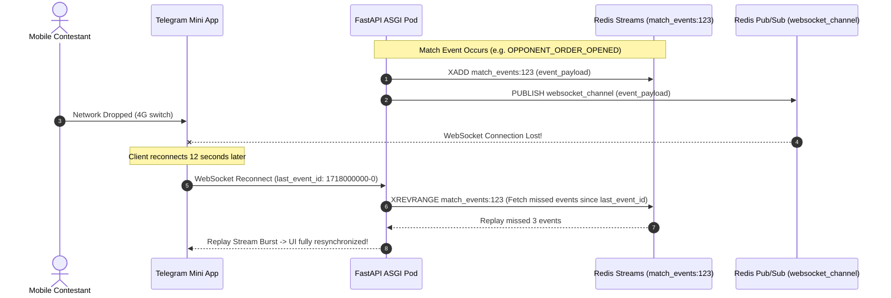

# 📐 Architectural Specification 04: Real-Time WebSocket & Event Recovery Engine

## 1. Why Standard WebSockets Fail in Live Trading Arenas

In mobile environments and Telegram Mini Apps, network connections fluctuate constantly:
- When a trader switches from Wi-Fi to 4G LTE or locks their smartphone screen, their WebSocket disconnects.
- During this offline window, match events occur: opposing trader opens a position, round time countdown reaches zero, or match status changes to `completed`.
- If an application relies solely on ephemeral WebSockets, the trader returns to a **stale or corrupted UI state**.

F2F Arena solves this through a **Hybrid Pub/Sub and Redis Streams Event Recovery Architecture**:



---

## 2. Event Recovery Implementation (`event_recovery.py`)

```python
class EventRecovery:
    \"\"\"
    Context-aware Event Recovery Engine utilizing Redis Streams.
    Keys are partitioned by context: match_events:{id}, tournament_events:{id}.
    \"\"\"
    SKIP_EVENTS = {'VIEW_COUNT_UPDATE', 'CHAT_MESSAGE'}

    def __init__(self, redis_client: redis.Redis):
        self.redis = redis_client
        self.event_ttl = 300       # 5 minutes TTL
        self.max_stream_len = 100  # Cap stream length to 100 entries

    async def save_match_event(self, match_id: int, event: dict) -> bool:
        if event.get('type') in self.SKIP_EVENTS:
            return False

        event['_saved_at'] = datetime.utcnow().timestamp()
        stream_key = f"match_events:{match_id}"

        # XADD with MAXLEN ~ 100 to optimize Redis memory
        await self.redis.xadd(
            stream_key,
            {'data': json.dumps(event)},
            maxlen=self.max_stream_len,
            approximate=True
        )
        await self.redis.expire(stream_key, self.event_ttl)
        return True

    async def get_missed_events(self, match_id: int, count: int = 20) -> list:
        stream_key = f"match_events:{match_id}"
        raw_events = await self.redis.xrevrange(stream_key, count=count)
        
        events = []
        for event_id, data in reversed(raw_events):
            parsed = json.loads(data['data'])
            parsed['_event_id'] = event_id
            events.append(parsed)
        return events
```

---

## 3. High-Performance Cross-Pod WebSocket Multiplexing

All connected clients subscribe to topics via a single persistent Redis Pub/Sub channel (`websocket_channel`). 
- When an event arrives from Pub/Sub, the local pod iterates over its in-memory active WebSocket connections matching the `match_id` or `tournament_id` and dispatches the payload in non-blocking asyncio tasks.
- If an individual client write fails due to socket disconnect, the pod drops the client safely from memory without affecting other active streams.
