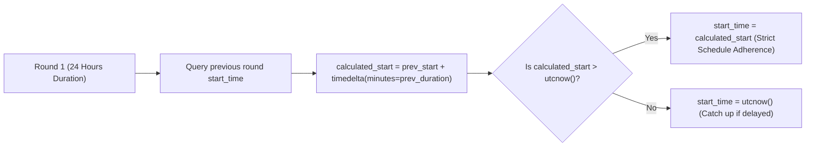

# 🔬 Engineering Deep-Dive 01: Round Timing & Bracket Progression Fairness

## 1. The Dilemma: Eliminating Manual Round Triggers

In multi-round tournaments, early designs relied on human tournament directors to manually trigger the next round. This led to serious operational hazards:
- **Round Drift:** If an admin was 10 minutes late clicking "Start Next Round", the entire tournament schedule drifted, causing participants in different time zones to miss their trading sessions.
- **Premature Starts:** If an admin triggered Round 2 while some Round 1 matches were still settling, incomplete results corrupted bracket seeds.

F2F Arena implements a **Deterministic Round Timing Calculation Engine**:



---

## 2. Production Implementation (`tournament_management.py`)

```python
# Deterministic round timing logic
start_time_utc = datetime.utcnow()

if round_number > 1:
    # Query previous round start time and planned duration
    cursor.execute("""
        SELECT MIN(start_time), total_round_duration_minutes
        FROM tournament_matches tm
        JOIN tournament_rounds tr ON tm.tournament_id = tr.tournament_id
        WHERE tm.tournament_id = %s AND tr.round_number = %s
    """, (tournament_id, round_number - 1))
    
    prev_round = cursor.fetchone()
    if prev_round and prev_round["start_time"]:
        prev_start = prev_round["start_time"]
        prev_duration = prev_round["total_round_duration_minutes"]
        calculated_start = prev_start + timedelta(minutes=prev_duration)
        
        # Enforce exact schedule boundary
        if calculated_start > datetime.utcnow():
            start_time_utc = calculated_start
```

### Key Engineering Benefits
1. **Zero Database Migrations:** Reuses existing `total_round_duration_minutes` fields without schema bloat.
2. **Safe Fallback:** If calculation fails, gracefully falls back to `datetime.utcnow()`.
3. **Immutable Predictability:** Contestants can plan their daily trading routines hours in advance with guaranteed start times.
