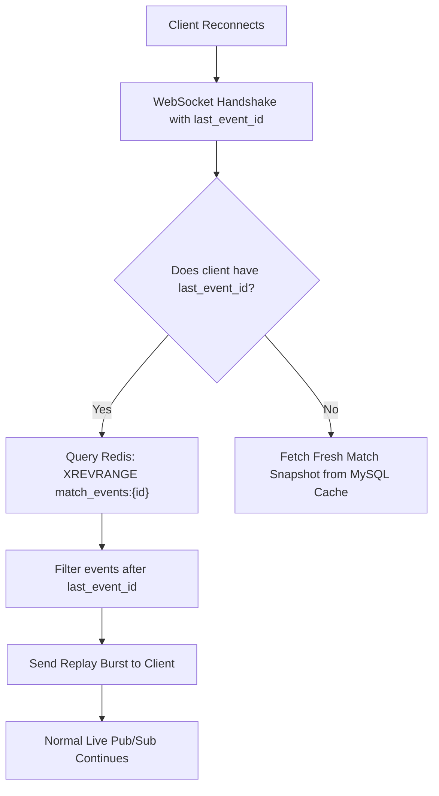

# 🔬 Engineering Deep-Dive 02: Multi-Pod Redis Stream Event Recovery Architecture

## 1. Overcoming the Pitfalls of Ephemeral WebSockets

In financial trading, missing a trade update during a 10-second connection dip can lead to catastrophic user dissatisfaction. 

Traditional architectures attempt to solve this via:
- **Heavy Database Polls on Reconnect:** Having every reconnecting client query MySQL causes severe thundering herd DB spikes during network blips.
- **In-Memory Buffer in Pods:** Pods run in Kubernetes with autoscaling and rolling updates; if Pod A dies, its in-memory event buffer is lost forever.

MyDNA and F2F Arena adopt **Partitioned Redis Streams (`XADD` / `XREVRANGE`)**:

---

## 2. Memory & TTL Pruning Strategies

To prevent unbounded Redis memory expansion across thousands of concurrent tournaments:
- **Stream Capping:** Streams are written using `maxlen=100, approximate=True`, capping stream nodes to 100 entries at O(1) CPU cost.
- **Key Expiry:** Every `save_event` resets the Redis TTL to 300 seconds (5 minutes). Once a match concludes, the entire stream key expires automatically.
- **Selective Event Ingestion:** Noise events like `VIEW_COUNT_UPDATE` or `CHAT_MESSAGE` bypass the recovery stream completely, reserving stream I/O strictly for state-critical transitions (`ORDER_OPENED`, `ORDER_CLOSED`, `MATCH_SETTLED`).
