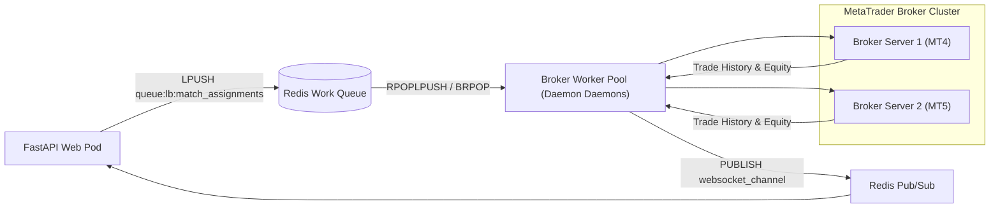

# 🔬 Engineering Deep-Dive 03: Trading Server Load Balancer & Broker Dispatch Queue

## 1. Decoupling Web API from Broker Trade Crawlers

A single tournament may encompass hundreds of active trading matches. If API pods directly polled MetaTrader broker bridges, the entire web tier would experience:
- Socket exhaustion and thread pool starvation.
- Latency amplification from slow broker network responses.
- Security vulnerabilities from holding live broker admin credentials in frontend-facing pods.

F2F Arena decouples this through a **Dedicated Load Balancer Work Queue (`queue:lb:match_assignments`)**:

---

## 2. Dispatch Payload Security & Formatting

Credentials passed into `queue:lb:match_assignments` are formatted with strict isolation:
- Passwords and account tokens are only passed into the queue when status transitions to `pending_confirmation`.
- Duration includes an automated **3-minute grace period** (`duration_minutes + 3`) to allow trading server bots to establish sessions and close pending market orders cleanly before hard settlement.
- Once a match ends, accounts are immediately detached from the player profile and recycled via the broker management daemon.
