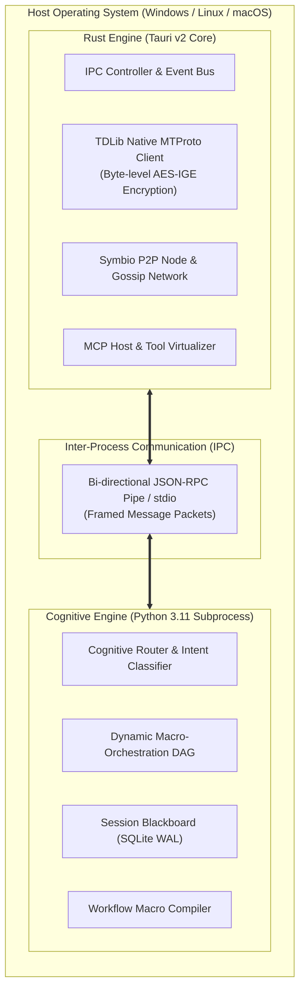
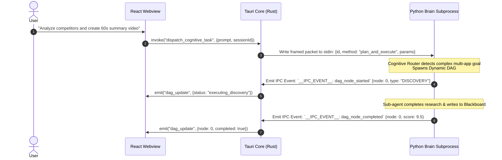

# 🏛️ Architecture: Hybrid Rust (Tauri) & Python Brain System Overview

## 1. Architectural Philosophy: The Dual-Engine Runtime

Building a rich desktop SuperApp that combines **deep OS integration**, **high-speed networking**, and **autonomous AI reasoning** creates an inherent runtime conflict:
- **Python** is the undisputed lingua franca for AI reasoning, prompt templating, dynamic code synthesis, and LLM orchestration. However, Python suffers from the **Global Interpreter Lock (GIL)**, high memory usage per thread, and poor native desktop UI integration.
- **Rust** provides memory safety without garbage collection, microsecond I/O concurrency via `tokio`, direct C/C++ FFI bindings (essential for TDLib Telegram MTProto), and lightweight desktop distribution via **Tauri v2**. However, writing rapidly evolving LLM multi-agent cognitive loops with dynamic schema parsing in Rust leads to excessive compile times and rigid type constraints.

Fusio resolves this through a **Hybrid Dual-Engine Architecture**:

---

## 2. Precise Boundary Separation (Anti-Pattern Prevention)

To prevent architectural overlap and maintain strict separation of concerns, the platform enforces hard boundary rules:

### Rust Responsibilities (Performance, I/O & OS Layer):
1. **Telegram MTProto Binary Protocol:** Manages authentication handshakes, persistent TCP sockets with Telegram datacenters, and background file uploads/downloads up to 4GB. Handling media streaming in Rust completely eliminates Python GIL contention and memory spikes.
2. **Desktop Windowing & System Integration:** Manages native window frames, system tray menus, hardware notifications, and Webview window lifecycles.
3. **P2P Gossip Network & Consensus:** Handles raw network packet exchange, block verification, and cryptographic signing for the decentralized Symbio network.
4. **Child Process Supervision:** Spawns the Python Brain daemon upon application launch, monitors its PID, captures stdout/stderr logs, and terminates subprocesses cleanly on shutdown.

### Python Responsibilities (Cognitive Reasoning & Adaptive Workflow):
1. **Intent Classification & Mindset Shaping:** Determines whether incoming prompts require simple conversational chit-chat, a single skill tool call, or a multi-step dynamic DAG.
2. **Dynamic Task Decomposition:** Breaks down ambiguous user commands into recursive DAG nodes with dynamic evaluation criteria.
3. **Session Working Memory (Blackboard):** Manages SQLite WAL working state, trajectory histories, and cross-agent memory reads/writes.
4. **Deterministic Macro Synthesis:** Inspects completed ReAct traces and compiles them into standalone Playwright scripts for zero-token re-execution.

---

## 3. Communication Protocol: IPC Message Framing

Communication between the Tauri Rust host and the Python Brain occurs over a dedicated bi-directional framed stream. Messages are formatted as structured events:

