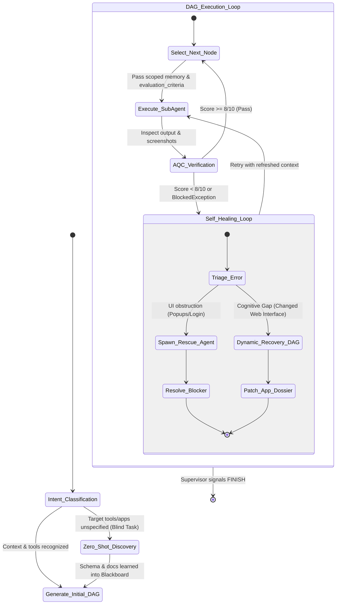
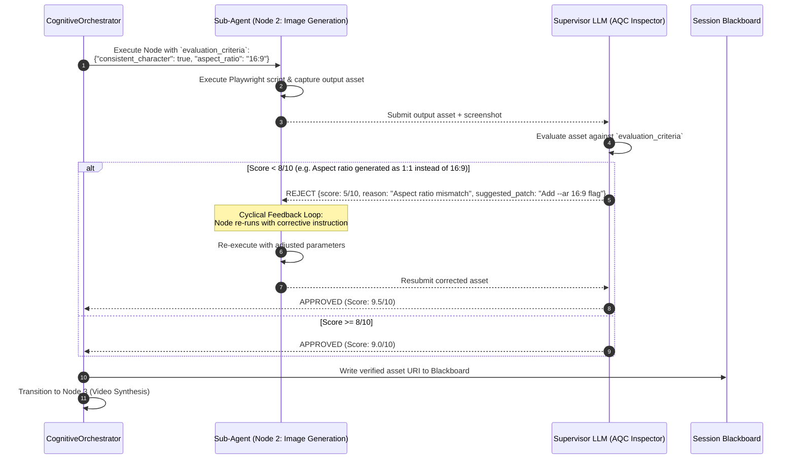

# 🔄 Architecture: Dynamic Macro-Orchestration DAG & Autonomous Quality Control (AQC)

## 1. Beyond Static SOPs: The Dynamic State Graph

Traditional automation tools rely on static, hardcoded Standard Operating Procedures (SOPs). If a web UI changes by a single button or an authentication wall appears, static pipelines crash.

Fusio implements an adaptive **Dynamic State Graph** (similar to LangGraph) managed by the `CognitiveOrchestrator`:
- Nodes in the graph are not hardcoded functions; they are dynamically generated sub-agent goals.
- Transitions between nodes are evaluated at runtime by a **State Graph Supervisor** inspecting the shared **Session Blackboard**.
- The graph supports loops, dynamic branching, and recursive node insertion.



---

## 2. Zero-Shot Discovery (Node 0)

When a user provides an open-ended command without specifying tools or application endpoints (e.g. *"Create a 60-second animated video explaining photosynthesis from text"*):
1. The `CognitiveOrchestrator` does not reject the command or hallucinate non-existent API parameters.
2. It dynamically prepends **Node 0 (Zero-Shot Discovery)** to the execution plan.
3. Node 0 activates browser and search tools to investigate currently available services, evaluate API/UI ergonomics, crawl documentation, and write a structured capability profile into the **App Skill Dossier**.
4. Once Node 0 finishes, the orchestrator recursively calls itself, synthesizing execution nodes (Scriptwriting -> Voiceover Synthesis -> Video Stitching) grounded in the newly acquired knowledge.

---

## 3. Autonomous Quality Control (AQC)

A critical failure mode in multi-agent workflows is the **compounding error cascade**: an early node produces a slightly flawed prompt or image, which causes subsequent nodes to produce unusable output.

Fusio implements **Autonomous Quality Control (AQC)**:



### Dynamic Criteria Enforcement:
Evaluation criteria are **never hardcoded**. The orchestrator extracts explicit constraints from the user prompt and translates them into machine-evaluable JSON criteria:
```json
{
  "node_id": "node_02_voiceover",
  "goal": "Generate professional voiceover audio",
  "evaluation_criteria": {
    "duration_min_sec": 55,
    "duration_max_sec": 65,
    "tone": "enthusiastic_educational",
    "required_language": "vi"
  }
}
```