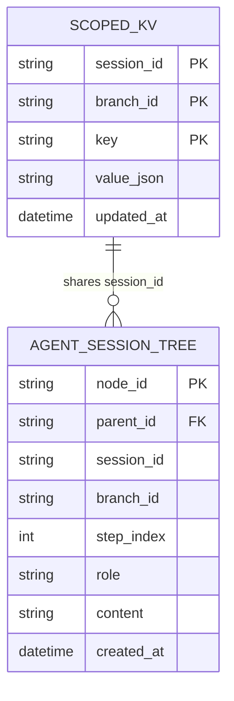

# 🧠 Architecture: Session Blackboard & Scoped Working Memory

## 1. The Storage Dilemma in Complex Multi-Agent Loops

In multi-agent systems executing multi-step tasks across disparate context windows:
1. **JSON Sidecars Cause Concurrency Corruption:** Saving agent trajectories or variable maps into `.json` sidecar files causes race conditions and file-locking collisions when sub-agents execute parallel branches.
2. **LLM Context Window Saturation:** Stuffing raw browser DOM trees, screenshots, and extensive intermediate steps into the system prompt exhausts context windows and causes exponential latency and token cost inflation.
3. **In-Memory Volatility:** Storing state solely in runtime RAM objects causes complete task loss if the desktop app restarts or experiences an OS crash.

Fusio implements the **Session Blackboard Architecture**, backed by an embedded **SQLite engine running in Write-Ahead Logging (WAL) mode**.

---

## 2. Relational Schema: Scoped KV & Agent Session Tree



### Table 1: `scoped_kv` (Working Memory Store)
Stores typed variables produced by one agent and needed by downstream agents:
```sql
CREATE TABLE IF NOT EXISTS scoped_kv (
    session_id TEXT NOT NULL,
    branch_id TEXT NOT NULL,
    key TEXT NOT NULL,
    value_json TEXT NOT NULL,
    PRIMARY KEY (session_id, branch_id, key)
);
```
- **Hierarchical Scoping:** A sub-agent in branch `branch_rescue_01` can read keys from parent branch `main` while maintaining private overrides for its own execution scope.
- **Microsecond Latency:** Reads and writes execute in **< 0.1ms** via local SQLite memory pages.

### Table 2: `agent_session_tree` (Branching Trajectory Graph)
Stores the complete thought-action-observation trace in an indexed tree structure, allowing sub-agents to branch off from any historical step:
```sql
CREATE TABLE IF NOT EXISTS agent_session_tree (
    node_id TEXT PRIMARY KEY,
    parent_id TEXT,
    session_id TEXT NOT NULL,
    branch_id TEXT NOT NULL,
    step_index INTEGER NOT NULL,
    role TEXT NOT NULL,
    content TEXT NOT NULL,
    created_at TIMESTAMP DEFAULT CURRENT_TIMESTAMP
);
```

---

## 3. High-Performance Concurrency: SQLite WAL Mode

The Blackboard initializes SQLite with strict performance pragmas:
```python
conn.executescript("""
    PRAGMA journal_mode = WAL;          -- Allows concurrent readers while writing
    PRAGMA synchronous = NORMAL;        -- 10x faster disk sync without data loss
    PRAGMA cache_size = -64000;         -- 64MB in-memory cache allocation
    PRAGMA foreign_keys = ON;
""")
```

### Key Architectural Benefits:
1. **Zero-Latency Data Transfer:** When Node 1 finishes crawling product prices, it calls `blackboard.set("crawled_products", items)`. Node 2 reads `blackboard.get("crawled_products")` instantly with zero serialization file I/O overhead.
2. **Resilient Crash Checkpoints:** If the user machine shuts down during step 8 of a 15-step DAG, the system restarts, detects the existing `session_id`, restores the exact Blackboard variables and resume step, and seamlessly continues without re-running steps 1–7.