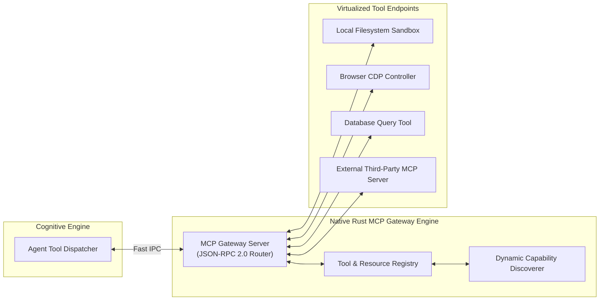

# 🌐 Architecture: P2P Symbio Node & Model Context Protocol (MCP) Gateway

## 1. Decentralized Skill Sharing & The Symbio Node

In traditional AI ecosystems, skill recipes and automation scripts reside on centralized servers. If the central provider shuts down or censors an automation pipeline, the client platform breaks.

Fusio incorporates the **Symbio Node**, an embedded P2P decentralized node written natively in Rust (`src-tauri/src/symbio_node/`):

```mermaid
graph TB
    subgraph LocalHost["Local Desktop Machine"]
        FUSIO_BRAIN["Python Cognitive Brain"]
        TAURI_BRIDGE["Tauri Rust Kernel"]
        SYMBIO_NODE["Symbio P2P Node (Rust)\n• P2P Gossip Protocol Engine\n• Local Consensus & Block Store\n• Proof-of-Execution Verifier"]
    end

    subgraph P2PMesh["Decentralized Peer Network"]
        PEER_A["Peer Node A (Germany)"]
        PEER_B["Peer Node B (Singapore)"]
        PEER_C["Peer Node C (USA)"]
    end

    FUSIO_BRAIN <--> TAURI_BRIDGE
    TAURI_BRIDGE <--> SYMBIO_NODE
    SYMBIO_NODE <==>|LibP2P GossipSub (TCP/TLS)| PEER_A
    SYMBIO_NODE <==>|LibP2P GossipSub (TCP/TLS)| PEER_B
    SYMBIO_NODE <==>|LibP2P GossipSub (TCP/TLS)| PEER_C
```

### Core P2P Capabilities:
1. **P2P Gossip Protocol (`p2p_gossip.rs`):** High-speed epidemic broadcast protocol disseminating verified Skill Dossiers, reputation updates, and decentralized task announcements across peer nodes.
2. **Skill Dossier Marketplace with Tokenomic Royalties:**
   - When a node creates an optimized automation dossier for an application, it signs the package cryptographically and broadcasts it.
   - When other nodes download the dossier, a micro-royalty fee is paid to the creator node in protocol native tokens (FWNC).
3. **P2P Blind Execution:**
   - Compute-heavy tasks (such as training local models or processing large datasets) can be offloaded to peer nodes.
   - Using asymmetric payload encryption, remote nodes compute the job without being able to view sensitive user inputs.

---

## 2. Model Context Protocol (MCP) Gateway Architecture

To standardize integration with third-party desktop tools, external IDEs, filesystem sensors, and remote services, Fusio implements the **Model Context Protocol (MCP)** natively in Rust (`src-tauri/src/mcp/`):



### Why Implement MCP in Rust Instead of Python?
1. **Cross-Subprocess Multiplexing:** The Rust MCP server acts as a centralized proxy. Both the local Python Brain and external tools can connect to the same MCP endpoint simultaneously.
2. **Zero-Copy Security Sandbox:** Rust enforces strict directory whitelisting and resource access limits before tool invocations ever touch the OS filesystem.