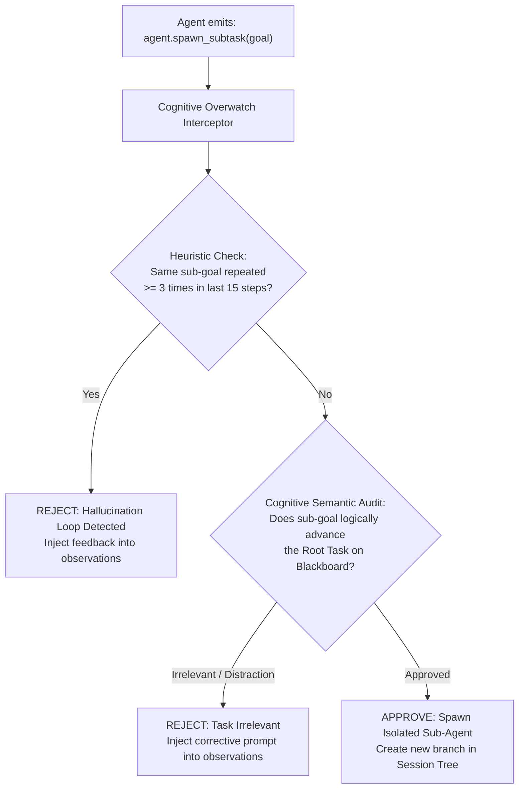

# 🔬 Deep Dive: Cognitive Overwatch vs. Rigid Depth Limits

In autonomous agent architectures, managing recursive sub-task spawning (`agent.spawn_subtask`) presents a major architectural dilemma: **Infinite Hallucination Loops vs. Problem-Solving Freedom**.

---

## 1. The Anti-Pattern: Hardcoded Depth Limits (`max_depth = 2`)

Many early agent frameworks attempt to avoid infinite loops by setting a hard limit:
```python
# ANTI-PATTERN in traditional agent frameworks
if current_depth >= 2:
    raise MaxDepthExceededException("Sub-task limit reached")
```

### Why This Fails in Production:
- Real-world automation tasks frequently require deeper resolution chains:
  `Root: Post Video` -> `Sub 1: Download Media` -> `Sub 2: Solve Auth Wall` -> `Sub 3: Retrieve 2FA SMS Code`.
- An artificial ceiling at depth 2 aborts legitimate workflows right when the agent is solving the final blocker.
- Conversely, within depth 2, an agent can still enter a wasteful horizontal loop (calling the same failed tool 10 times in parallel).

---

## 2. Fusio's Solution: Cognitive Overwatch Layer

Fusio completely eliminates hardcoded depth limits. It replaces them with **State-Driven Resolution** enforced by the **Cognitive Overwatch Layer** (`cognitive_orchestrator.py`):



### Key Engineering Primitives:
1. **Sliding Observation Audit:** Scans the last 15 steps of historical trajectory to detect semantic repetition even if the exact string differs.
2. **Non-Crashing Feedback Injection:** When Overwatch rejects a runaway sub-task, it **does not crash the process**. Instead, it synthesizes an educational observation:
   ```json
   {
     "status": "error",
     "error": "[Overwatch Blocked] Re-attempting login bypass for the 3rd time without progress. Cease spawning sub-tasks and utilize web.search to locate alternative endpoints."
   }
   ```
   This forces the agent to self-correct and switch tools rather than terminating the pipeline.
3. **Progressive State Change Invariant:** As long as branching actions create demonstrable progress on the **Session Blackboard** (new tokens, verified DOM elements, saved files), execution depth is permitted to expand dynamically.