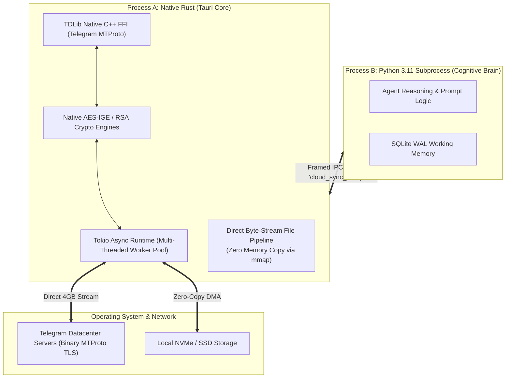

# ⚙️ Deep Dive: Process Isolation & Overcoming the Python GIL

Desktop AI applications that handle real-time streaming, high-volume chat messages, and multi-gigabyte media uploads simultaneously face fundamental concurrency limitations if built as a single Python process.

---

## 1. The Bottleneck: The Python Global Interpreter Lock (GIL)

In Python, the **Global Interpreter Lock (GIL)** ensures thread-safe memory management by allowing only one native operating system thread to execute Python bytecode at any given moment.

When a single Python desktop application attempts to:
1. Stream and decrypt Telegram MTProto binary packets,
2. Run local vector similarity searches (embeddings),
3. Render or manage UI event loops,
4. Stream tokens from remote LLMs...

...the GIL becomes a **catastrophic throughput bottleneck**. A single heavy JSON parsing operation or large file buffer encryption blocks all asynchronous timers, causing UI freezing and dropped socket heartbeats.

---

## 2. Fusio's Solution: Process Isolation & Native Rust Offloading

Fusio addresses this through strict process isolation: the heavy I/O network engine runs in a compiled native **Rust runtime (Tauri v2)**, completely independent of the Python interpreter.

### The Cloud Sync Breakthrough:
In early prototypes, Python attempted to upload 500MB backup files using `aiohttp` over the Telegram Bot API:
- Memory usage spiked to **1.8GB RAM** due to in-memory multipart buffer allocation.
- The 50MB file size limit enforced by the standard Bot API blocked database backups.
- Uploading saturated the Python event loop, causing Agent reasoning to pause.

### The Rust Re-Architecture:
1. Python simply compresses and writes the database backup to disk, then emits a lightweight IPC event: `{"event": "cloud_sync_ready", "path": "data/backup.tar.gz"}`.
2. The **Rust TDLib engine** picks up the path, authenticates via MTProto user-session keys, splits the file into 512KB chunks, and pipes them directly to Telegram servers across multiple concurrent worker threads.
3. Python memory impact: **0 MB**. Upload limit expanded from 50MB to **4,000 MB (4GB)**. Python event loop latency: **0 ms interruption**.