# 🏛️ Architecture: System Overview & Edge Microservices Topology

## 1. Edge Cluster Architecture & Workload Density

Running an enterprise backend suite on an edge bare-metal machine requires extreme optimization of memory allocation and container scheduling. Traditional Kubernetes distributions (like kubeadm or OpenShift) consume 2GB–3GB of memory just for the control plane.

The `local-server` architecture utilizes **K3d (Lightweight Kubernetes inside Docker)**:
- Control plane memory footprint: **< 500MB RAM**.
- Utilizes SQLite/Kine as the backend data store instead of a memory-heavy etcd cluster.
- Integrates a private, local Docker container registry running on `localhost:5000` to enable rapid, air-gapped image deployments without relying on external registries.

```mermaid
graph TD
    subgraph K3dCluster["K3d Cluster: 'mycluster' (Local Node)"]
        subgraph Registry["Private Container Registry"]
            REG["k3d-myregistry.localhost:5000\n(Holds all 10 Microservice Images)"]
        end

        subgraph NS_DB["Namespace: 'database' (Stateful Sets)"]
            MYSQL["MySQL 8.0 (mysql-local:3306)\nPVC: 20GB"]
            MONGO["MongoDB 6.0 (mongo-local:27017)\nPVC: 20GB"]
            REDIS["Redis 7.0 (redis:6379)\nIn-Memory Cache & Streams"]
            MQTT["Mosquitto (mosquitto:1883)\nPVC: 5GB"]
        end

        subgraph NS_APP["Namespace: 'tadagram' (Stateless Deployments)"]
            SVC1["orchestrator (Port 3000)"]
            SVC2["svc-core-api (Port 3000) + Sidecar (Port 3002)"]
            SVC3["svc-business-chatbot (Port 3000)"]
            SVC4["svc-business-crm (Port 5000)"]
            SVC5["svc-biztada-crm (Port 3000)"]
            SVC6["svc-business-marketing (Port 3000)"]
            SVC7["svc-ai-controller (Port 3100)"]
            SVC8["svc-tada-credit (Port 3000)"]
            SVC9["svc-observability (Port 8080)"]
        end
    end

    REG -->|Pull Images Locally| NS_APP
    NS_APP -->|Query / Write| NS_DB
```

---

## 2. Directory of Microservices & Resource Allocations

| # | Service Identifier | Primary Language | Storage Dependency | Ingress Hostname | Memory Limit |
| :--- | :--- | :--- | :--- | :--- | :--- |
| 1 | **`orchestrator`** | Go / Python | MongoDB, Redis | `orchestrator.tadagram.com` | 256 MiB |
| 2 | **`svc-core-api`** | Go | MySQL (`shellapp_db`), Redis | `core.tadagram.com` | 192 MiB |
| 3 | **`telegram-sidecar`** | Rust | Local Memory, MTProto Socket | *(Pod Sidecar to Core API)* | 128 MiB |
| 4 | **`svc-business-chatbot`** | Go | MySQL, MQTT, Redis | `business-chatbot.tadagram.com` | 256 MiB |
| 5 | **`svc-business-crm`** | Go | MySQL (`business-crm_db`), Redis | `business-crm.tadagram.com` | 192 MiB |
| 6 | **`svc-biztada-crm`** | Node.js / Go | MySQL (`biztada-crm_db`) | `biztada-crm.tadagram.com` | 256 MiB |
| 7 | **`svc-business-marketing`**| Go | MongoDB (`marketing_db`), Redis | `business-marketing.tadagram.com` | 384 MiB |
| 8 | **`svc-ai-controller`** | Python | Redis | `ai-controller.tadagram.com` | 512 MiB |
| 9 | **`svc-tada-credit`** | Go | MySQL (`tada-credit_db`) | `tada-credit.tadagram.com` | 128 MiB |
| 10| **`svc-observability`** | Go | MongoDB (`observability_db`) | `observability.tadagram.com` | 256 MiB |

---

## 3. Persistent Volume Strategy (Host-Binds vs. PVCs)

Running stateful databases in Kubernetes can lead to data loss if pods are rescheduled without proper storage persistence. The cluster applies a dual persistence strategy:
1. **PersistentVolumeClaims (PVCs):** Configured with local storage class (`local-path` provisioner) ensuring databases survive container crashes and pod recreations.
2. **Cold Backup Storage:** Hourly snapshot scripts dump compressed BSON and SQL dumps to a dedicated secondary NVMe directory (`/data/db-dumps/`) mounted outside the Docker container runtime.