# 🔒 Architecture: Zero-Trust Edge Ingress via Cloudflare Tunnels

## 1. The On-Premises Ingress Challenge

Traditional self-hosted server deployments suffer from severe networking vulnerabilities:
1. **Public IP Requirement:** ISPs usually charge extra for static public IPv4 addresses, which can still change during maintenance.
2. **Open Firewall Ports:** Port-forwarding port 80/443 on the home/office router directly exposes the internal LAN to internet scanners and automated DDoS attacks.
3. **Dynamic IP Changes:** If the ISP changes the IP address or failover triggers over 4G, public DNS records break until TTLs expire.

The `local-server` infrastructure completely eliminates open inbound ports using **Cloudflare Zero Trust Tunnels (`cloudflared`)**:

```mermaid
flowchart LR
    subgraph Clients["Public Clients"]
        WEB["Browser / Web Client\n(biztada.com)"]
        API_REQ["API Call\n(core.tadagram.com)"]
    end

    subgraph CF_Cloud["Cloudflare Global Anycast Edge Network"]
        EDGE["Cloudflare Edge\n• WAF & DDoS Shield\n• TLS Termination"]
        TUNNEL_GW["Cloudflare Tunnel Gateway"]
    end

    subgraph LocalMachine["Edge Mini PC (Zero Open Inbound Ports)"]
        CLOUDFLARED["cloudflared daemon\n(Persistent Outbound TLS Connection)"]
        TRAEFIK["Traefik Ingress Controller\n(Port 80/443 inside K3d)"]
        SERVICES["Kubernetes Cluster Services\n(ClusterIP: 10 Microservices)"]
    end

    Clients -->|Public HTTPS Request| EDGE
    EDGE --> TUNNEL_GW
    TUNNEL_GW == "Encrypted Outbound Tunnel\n(TCP/QUIC over port 7844)" ==> CLOUDFLARED
    CLOUDFLARED -->|Proxy to localhost:80| TRAEFIK
    TRAEFIK -->|Path / Host Routing| SERVICES
```



---

## 2. Ingress Traffic Routing Pipeline

1. **Outbound Handshake:** Upon boot, `cloudflared` initiates an outbound HTTPS connection to Cloudflare’s nearest Anycast edge nodes. No incoming router port is ever opened.
2. **SNI Routing & Hostname Mapping:** When a client accesses `core.tadagram.com`, Cloudflare matches the configured tunnel route and pipes the request through the existing outbound connection to `localhost:80`.
3. **Internal Cluster Resolution:** Traefik receives the HTTP request at the K3d node balancer and matches the Kubernetes Ingress resource:
   ```yaml
   apiVersion: networking.k8s.io/v1
   kind: Ingress
   metadata:
     name: core-api-ingress
     namespace: tadagram
   spec:
     rules:
     - host: core.tadagram.com
       http:
         paths:
         - path: /
           pathType: Prefix
           backend:
             service:
               name: svc-core-api
               port:
                 number: 3000
   ```

---

## 3. Instantaneous IP-Agnostic Failover

Because the connection is maintained **outbound from the edge node to Cloudflare**, the public internet never knows the physical IP address of the server. 
- If the primary internet link fails and the router switches to a **4G backup SIM** (changing the WAN IP address completely), `cloudflared` simply reconnects its outbound socket to Cloudflare.
- The global DNS record (`core.tadagram.com`) points to Cloudflare Anycast and **never changes**.
- User sessions experience **zero DNS propagation lag** and reconnect within 3–5 seconds.