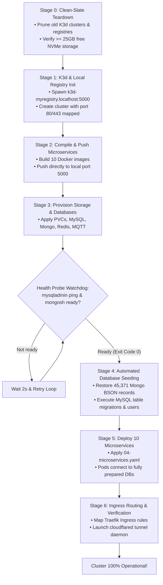

# ⚙️ Architecture: Deterministic 6-Stage Cluster Bootstrap

## 1. The Challenge of Bare-Metal Orchestration

In cloud platforms, managed databases and networking are abstracted by cloud APIs. On bare-metal edge hardware, deploying 10 interdependent microservices and 4 stateful databases from scratch often causes **race conditions**:
- Microservices start before MySQL has finished initial socket binding, causing crash-loops.
- Database restore scripts run while the storage daemon is still initializing tables, causing data corruption.
- Container registries external to the machine cause network timeouts during high-density image pulls.

To guarantee 100% reproducibility, the infrastructure utilizes a **Deterministic 6-Stage Bootstrap Workflow**:



---

## 2. Stage-by-Stage Implementation Details

### Stage 0: Teardown & Clean-Slate Reset
Guarantees zero configuration drift:
```bash
k3d cluster delete mycluster
k3d registry delete myregistry.localhost
docker system prune -af --volumes
```

### Stage 1: Local Registry & Cluster Binding
Creates an isolated Kubernetes control plane bound to a local registry:
```bash
k3d registry create myregistry.localhost --port 5000
k3d cluster create mycluster \
  --registry-use k3d-myregistry.localhost:5000 \
  -p "80:80@loadbalancer" \
  -p "443:443@loadbalancer"
```

### Stage 4: Active Health Probes Before Seeding
Microservices must never be scheduled until database schemas are guaranteed to be populated:
```bash
# MySQL Health Verification Loop
until docker exec -i $(docker ps -qf "name=mysql") mysqladmin ping -u root -proot --silent; do
    echo "Waiting for MySQL socket binding..."
    sleep 2
done

# MongoDB Seed Restoration (Over 45,000 records)
docker exec -i $(docker ps -qf "name=mongo") mongorestore --drop /data/db-dumps/mongo-dump/
```

### Stage 5 & 6: Zero-Restart Microservice Scheduling
Because downstream databases are completely healthy and pre-seeded before microservice manifests are applied, all 10 application pods reach `1/1 Running` status **on the very first attempt without a single restart event**.