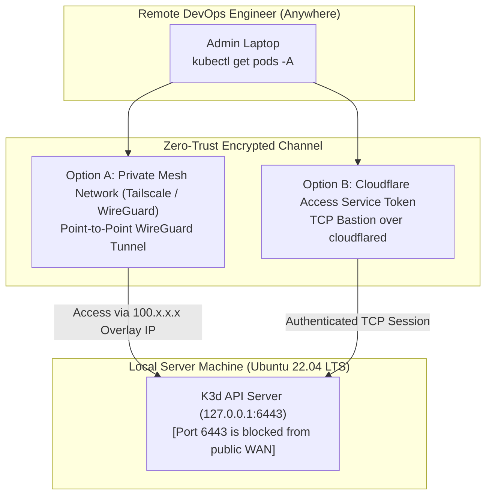

# 🔑 Architecture: Secure Remote Kubernetes Cluster Management

## 1. The Security Risk of Public Kubernetes API Endpoints

Exposing the Kubernetes API Server (port `6443`) to the public internet is one of the most common vectors for enterprise cloud compromises. Port scanners continuously probe exposed K8s clusters for misconfigured RBAC tokens and unpatched API vulnerabilities.

In the `local-server` infrastructure, the Kubernetes API Server is **strictly bound to the loopback interface (`127.0.0.1:6443`)**. Remote operators manage the cluster through secure, encrypted overlay channels.

---

## 2. Remote Management Topologies

Two secure connection topologies are supported for remote operations:



---

## 3. Kubeconfig Portability & Configuration

To allow team members to securely execute `kubectl` commands from remote machines without SSH-ing directly into the server:

1. **Extracting the Local Kubeconfig:**
   ```bash
   k3d kubeconfig get mycluster > ~/.kube/config-local-server
   ```
2. **Rewriting Server Endpoint:**
   By default, K3d outputs `server: https://0.0.0.0:6443`. When managing over a secure private mesh (e.g. Tailscale), the endpoint is mapped to the server's private node address:
   ```yaml
   apiVersion: v1
   clusters:
   - cluster:
       certificate-authority-data: LS0tLS...
       server: https://100.85.120.45:6443  # Private WireGuard/Tailscale IP
     name: k3d-mycluster
   ```
3. **RBAC Token Scoping:**
   Non-admin developers receive scoped ServiceAccount tokens restricted to the `tadagram` application namespace, completely isolating the `database` and `kube-system` control namespaces.