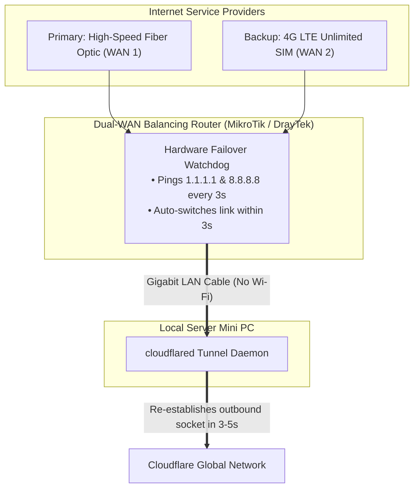
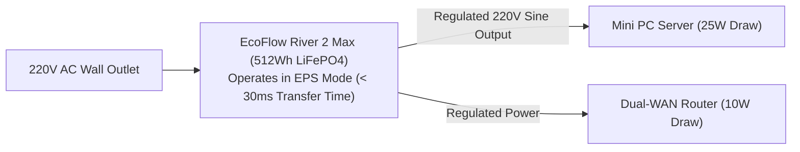

# 🔋 Deep Dive: Hardware Engineering, Dual-WAN & 14-Hour EPS Power Resilience

For mission-critical production systems, software fault-tolerance is meaningless if physical power or internet connectivity fails. This document outlines the physical engineering design powering the `local-server` node 24/7.

---

## 1. Hardware Specification: Low-Power Density

To maximize computing power while keeping heat and power consumption minimal:

| Component | Selected Hardware | Engineering Rationale |
| :--- | :--- | :--- |
| **Processor** | Intel Core i5-6500T (4 Cores, 4 Threads) | **35W TDP (Low Thermal Profile):** Generates virtually zero heat, runs whisper-quiet under continuous 24/7 load. |
| **System Memory** | 16GB DDR4 (2x 8GB Dual-Channel) | **Dual-Channel Bandwidth:** Critical for memory-heavy database engines (MongoDB FTS, MySQL buffer pools, and Redis in-memory storage). |
| **Storage** | 256GB NVMe M.2 SSD | **High IOPS Throughput:** Delivers 2,500+ MB/s read/write speeds, drastically outperforming cloud virtual block storage (AWS gp3 / DigitalOcean block volumes). |
| **Operating System** | Ubuntu Server 22.04 LTS (Headless) | Zero GUI overhead, reserving 98% of system RAM exclusively for Docker containers. |

---

## 2. Network Redundancy: Dual-WAN 4G LTE Automatic Failover

ISP fiber cuts or roadside maintenance can interrupt internet connectivity. The local datacenter deploys an enterprise dual-WAN failover architecture:

### Why Cloudflare Tunnel Makes Dual-WAN Seamless:
Traditional dynamic DNS (DDNS) takes 2–10 minutes for DNS records to update when a WAN IP changes from Fiber to 4G. 
Because `cloudflared` initiates outbound encrypted tunnels, the moment the router redirects packets over the 4G interface, `cloudflared` automatically negotiates a fresh session with Cloudflare within **3–5 seconds**. Outside clients browsing `biztada.com` never experience service downtime.

---

## 3. Power Resilience: 14-Hour Battery Backup (EPS Mode)

Traditional computer UPS battery backups (e.g. APC, Santak) use lead-acid batteries designed for 15–30 minutes of shutdown time, overheating rapidly if forced to run for hours.

The infrastructure utilizes an **Off-Grid Portable Power Station with LiFePO4 (Lithium Iron Phosphate) Chemistry**:

### Technical Metrics:
- **Total Infrastructure Draw:** ~35 Watts (Mini PC + Router + 4G Modem).
- **Battery Capacity:** 512 Watt-hours (Wh).
- **Usable Backup Runtime:** `(512 Wh * 0.85 efficiency) / 35 W` = **~12.4 to 14 Hours** of continuous full-load uptime.
- **EPS Transfer Latency:** < **30 milliseconds**. When grid power cuts, the internal inverter engages instantly, preventing server reboot or filesystem corruption.
- **Lifespan:** LiFePO4 cells maintain 80%+ capacity after 3,000+ discharge cycles (~10 years of continuous service).