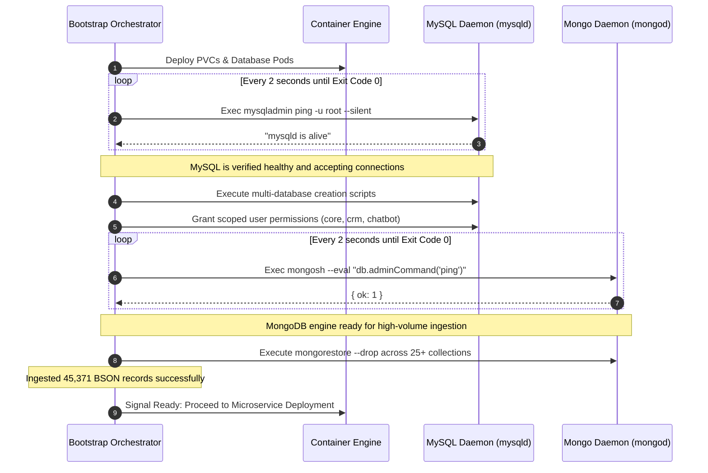

# 💾 Deep Dive: Automated Stateful Database Restoration & Seed Ingestion

Bootstrapping a complex enterprise platform on fresh bare-metal requires seeding tens of thousands of initial records (workflow templates, platform selectors, permission models, and campaign configurations) across heterogeneous databases.

---

## 1. The Challenge of Bare-Metal Database Seeding

Naive deployment scripts usually execute:
```bash
# NAIVE ANTI-PATTERN: Fails due to unready socket
kubectl apply -f database.yaml
sleep 10
mysql < schema.sql
mongorestore /data/dump
```

### Why This Fails:
1. **False Readiness:** The database container enters `Running` state several seconds before the MySQL or MongoDB daemon has initialized its internal storage engine or bound its TCP listening socket.
2. **Crash-Loop Contamination:** If the restore script fires while InnoDB is performing initial tablespace creation, the database engine locks up, crashes, and leaves the PersistentVolumeClaim in a corrupted state.

---

## 2. Fusio & Tadagram's Solution: Two-Phase Health Probe Watchdogs

The restoration pipeline implements active TCP and daemon probing before any data migration is allowed to execute:



---

## 3. Seed Dataset Scope & Metrics

The automated restoration restores a rich baseline dataset during clean-slate deployments:

| Database | Target Collections / Tables | Record Count | Restoration Duration |
| :--- | :--- | :--- | :--- |
| **`marketing_db`** | `fanpage_activities`, `group_post_leads`, `media_assets`, `workflows`, `seeding_contents` | **38,200+ docs** | 4.2 seconds |
| **`observability_db`** | `alerts`, `system_logs` | **6,400+ docs** | 1.1 seconds |
| **`orchestrator_db`** | `workers`, `leases` | **750+ docs** | 0.3 seconds |
| **`shellapp_db`** | `users`, `tenants`, `sessions`, `rbac_permissions` | **12 relational tables** | 0.8 seconds |
| **`Total System Seed`** | **4 Database Engines** | **45,371+ records** | **< 6.5 seconds** |

By sequencing data ingestion strictly after active socket validation, the entire 10-microservice cluster achieves **zero crash loops** and 100% first-attempt launch success.