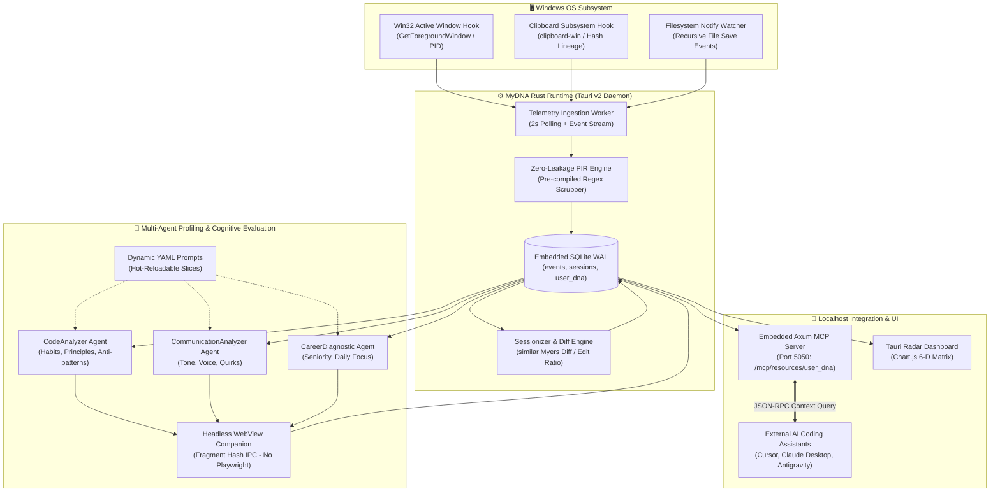

# 🧬 MyDNA: Decentralized AI-Coworker Passport & Real-Time Telemetry Engine

[](https://github.com/DrLucifer1810/system-architecture-case-studies)
[](https://www.rust-lang.org/)
[](https://tauri.app/)
[-6366f1?style=flat-square)](https://modelcontextprotocol.io/)
[](LICENSE)

[🌐 English Architecture Specification](./en/README.md) | [🇻🇳 Hồ Sơ Kiến Trúc Tiếng Việt](./vi/README.md)

---

## 📌 Executive Summary / Tóm Tắt Dự Án

**MyDNA** is a decentralized, background agentic telemetry daemon that acts as an objective **"Skill Passport"** for software engineers and knowledge workers. Instead of relying on static self-reported resumes or crude click/keystroke counters, MyDNA passively monitors real-world developer workflows at the operating system level, analyzes human-AI collaboration dynamics, strips private data locally, and compiles an actionable, verifiable competency profile.

Unlike traditional surveillance spyware, MyDNA operates under a **Zero-Knowledge, Privacy-First Architecture**:
- All raw telemetry is scrubbed on-device via a native **Privacy Information Redaction (PIR)** engine before reaching any evaluation models.
- Workflows are evaluated across a **6-Dimensional Enterprise Competency Matrix** (Bloom's Taxonomy & Dreyfus Skill Acquisition Model).
- Developer traits, good/bad habits, and communication styles are exposed locally via an embedded **Model Context Protocol (MCP)** server on `localhost:5050`, allowing external AI assistants (Cursor, Claude, Antigravity) to personalize prompts with zero cloud dependency.

---

## 🏛️ High-Level System Architecture



---

## 📁 Repository Structure / Cấu Trúc Tài Liệu

```text
projects/mydna-ai-coworker-passport/
├── README.md                                 # Bilingual Landing Hub (Current)
├── en/                                       # Complete English Edition
│   ├── README.md                             # English Executive Architecture Spec
│   ├── architecture/
│   │   ├── 01-system-overview.md             # Native OS Telemetry Engine & Desktop Stack
│   │   ├── 02-privacy-redaction-pipeline.md  # Client-Side Zero-Leakage PIR Filter
│   │   ├── 03-evaluation-matrix-engine.md    # 6-Dimension Radar Matrix & Semantic Edit Ratio
│   │   └── 04-embedded-mcp-server.md         # Localhost Axum JSON-RPC MCP Server (Port 5050)
│   └── deep-dives/
│       ├── 01-win32-clipboard-lineage.md     # Low-level Win32 Hooks, Hashing & Lineage Tracking
│       ├── 02-hot-reload-multi-agent-dna.md  # Dynamic YAML Profilers (Code, Comm, Career)
│       └── 03-headless-companion-ipc.md      # Headless Webview URL-fragment IPC vs Playwright
│
├── vi/                                       # Complete Vietnamese Edition
│   ├── README.md                             # Tổng quan kiến trúc & giải pháp cốt lõi
│   ├── architecture/
│   │   ├── 01-system-overview.md             # Động cơ Telemetry tầng OS & Hệ sinh thái Desktop lai
│   │   ├── 02-privacy-redaction-pipeline.md  # Đường ống lọc và che giấu dữ liệu nhạy cảm (PIR)
│   │   ├── 03-evaluation-matrix-engine.md    # Ma trận Radar 6 chiều & Tỷ lệ sửa đổi mã Semantic Edit
│   │   └── 04-embedded-mcp-server.md         # Máy chủ nhúng MCP Server Axum (Cổng 5050)
│   └── deep-dives/
│       ├── 01-win32-clipboard-lineage.md     # Hook Win32 bậc thấp, Phả hệ Clipboard & Theo dõi tiến trình
│       ├── 02-hot-reload-multi-agent-dna.md  # Bộ hồ sơ đa Agent tải động YAML (Code, Giao tiếp, Nghề nghiệp)
│       └── 03-headless-companion-ipc.md      # Cơ chế IPC Webview ẩn qua URL-fragment thay thế Playwright
│
└── sanitized-code/                           # Production-grade runnable implementations
    ├── rust-telemetry-pir-engine/            # Compilable Rust crate: Win32 hook, clipboard hash, PIR scrubber
    ├── rust-axum-mcp-server/                 # Compilable Rust crate: Axum MCP server on port 5050
    └── python-evaluation-prompt-compiler/    # Runnable Python: Edit ratio diffing & Dreyfus prompt builder
```

---

## ⚡ Core Technical Metrics

| Metric | Target / Production Value | Engineering Achievement |
| :--- | :--- | :--- |
| **Telemetry Daemon CPU Overhead** | `< 0.3% CPU` | 2-second adaptive polling loop with Win32 native APIs; zero polling during sleep |
| **Memory Footprint** | `< 28 MB RAM` | Rust native binary compiled with Tauri v2; WebView2 shared OS memory |
| **Privacy Redaction Throughput** | `> 450 MB/sec` | `OnceLock` singleton pre-compiled regex; zero heap allocation on clean buffers |
| **Edit Ratio Precision** | `100% Deterministic` | Myers diff line-level classification (`similar` crate) correlating copy-to-save |
| **MCP Query Response Latency** | `< 1.2 ms` | Axum asynchronous in-memory SQLite query cache serving JSON-RPC |
| **Browser Companion Overhead** | `0 MB extra binary` | Reuses existing Tauri webview window instead of bundling 200MB Chromium/Playwright |
