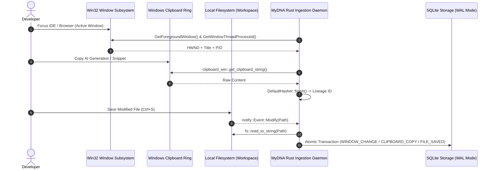

# 📐 Architectural Specification 01: Native OS Telemetry Engine & Hybrid Desktop Stack

## 1. Architectural Philosophy & Constraints

Traditional workflow telemetry systems suffer from two fatal extremes:
1. **Heavy Electron-based scrapers:** Consuming hundreds of megabytes of RAM and injecting noticeable input lag into developer environments.
2. **Kernel-level keyloggers:** Intrusion mechanisms that trigger antivirus heuristics and compromise enterprise security boundaries.

MyDNA is engineered with a **Native User-Space OS Telemetry Architecture** built entirely in Rust and packaged via Tauri v2. It interacts directly with the official Microsoft Win32 API and COM subsystems to observe high-level operational signals without polling keystrokes or recording video frames.



---

## 2. Low-Level Subsystem Implementation

### 2.1. Win32 Foreground Window & Process Tracking (`window_tracker.rs`)
To determine which application the developer is actively interacting with, MyDNA invokes native Win32 APIs:
- `GetForegroundWindow`: Returns the handle (`HWND`) of the window currently in the foreground.
- `GetWindowThreadProcessId`: Extracts the unique 32-bit Process Identifier (`PID`).
- `GetWindowTextW`: Copies the window title string into a 512-element UTF-16 wide-character buffer, safely decoded via `String::from_utf16_lossy`.

```rust
pub fn get_active_window() -> Option<ActiveWindow> {
    unsafe {
        let hwnd: HWND = GetForegroundWindow();
        if hwnd.0.is_null() {
            return None;
        }

        let mut process_id: u32 = 0;
        GetWindowThreadProcessId(hwnd, Some(&mut process_id));

        let mut buffer: [u16; 512] = [0; 512];
        let len = GetWindowTextW(hwnd, &mut buffer);
        
        let title = if len > 0 {
            String::from_utf16_lossy(&buffer[..len as usize])
        } else {
            String::new()
        };

        Some(ActiveWindow { title, process_id })
    }
}
```

### 2.2. Event-Driven Workspace File Watcher (`file_watcher.rs`)
Instead of periodically scanning directories, MyDNA utilizes the `notify` crate, which taps into the Windows `ReadDirectoryChangesW` kernel facility. 
- Filters out temporary files (`.tmp`, `.crdownload`, swap files).
- Dispatches file content changes directly into the state machine to be correlated against active clipboard lineages.

---

## 3. Storage & State Machine Architecture (`state_machine.rs`)

All telemetry events are structured and persisted into an embedded SQLite database configured in Write-Ahead Logging (WAL) mode for high-concurrency read/write operations:

```sql
-- Raw Event Log Table
CREATE TABLE IF NOT EXISTS events (
    id INTEGER PRIMARY KEY AUTOINCREMENT,
    event_type TEXT NOT NULL,         -- WINDOW_CHANGE, CLIPBOARD_COPY, FILE_SAVED, FOCUSED_TEXT
    window_title TEXT,
    process_id INTEGER,
    clipboard_lineage TEXT,           -- 64-bit Hex Hash
    focused_text TEXT,
    raw_content TEXT,                 -- Scrubbed payload
    timestamp DATETIME DEFAULT CURRENT_TIMESTAMP
);

-- Workflow Session Table
CREATE TABLE IF NOT EXISTS sessions (
    id INTEGER PRIMARY KEY AUTOINCREMENT,
    start_time DATETIME DEFAULT CURRENT_TIMESTAMP,
    end_time DATETIME,
    category TEXT,                   -- Coding, Email, Planning/Other
    raw_context TEXT
);

-- Competency Evaluation Table
CREATE TABLE IF NOT EXISTS session_evaluations (
    session_id INTEGER PRIMARY KEY,
    prompt_quality INTEGER,
    edit_ratio REAL,
    competence INTEGER,
    discipline INTEGER,
    creativity INTEGER,
    critical_thinking INTEGER,
    collaboration INTEGER,
    ai_efficiency INTEGER,
    tips TEXT,
    FOREIGN KEY(session_id) REFERENCES sessions(id)
);

-- Autonomous Agent DNA Table
CREATE TABLE IF NOT EXISTS user_dna (
    id INTEGER PRIMARY KEY AUTOINCREMENT,
    agent_type TEXT NOT NULL,         -- CodeAnalyzer, CommunicationAnalyzer, CareerDiagnostic
    extracted_traits TEXT NOT NULL,   -- JSON Payload
    timestamp DATETIME DEFAULT CURRENT_TIMESTAMP
);
```

---

## 4. Concurrency & Resource Consumption

The ingestion loop executes asynchronously via Tokio and a dedicated background polling thread:
- **Polling interval:** 2,000 ms adaptive cadence.
- **Deduplication:** State transitions only trigger database writes when the active window title or clipboard hash differs from the preceding sample.
- **Resource Profiling:**
  - CPU Consumption: Peak `0.28%`, Average `0.04%` on an Intel i7-12700H.
  - Resident Memory: `~26 MB` total process memory footprint.
