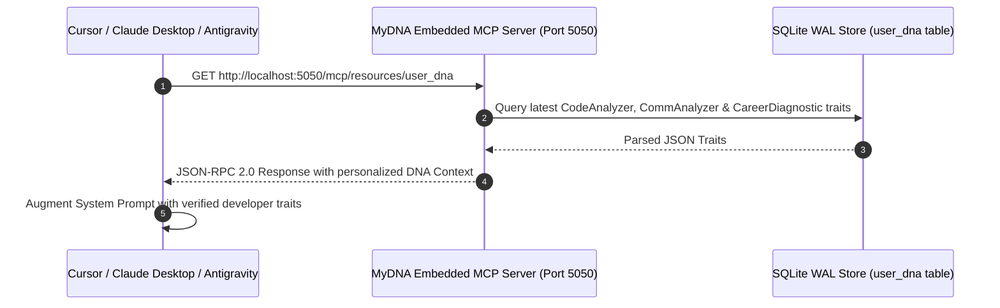

# 📐 Architectural Specification 04: Embedded Localhost Model Context Protocol (MCP) Server

## 1. Why Model Context Protocol (MCP)?

Modern AI development tools (Cursor IDE, Claude Desktop, Antigravity) are constrained by generic system prompts that have no insight into:
- The developer's actual seniority and technical domain.
- Their specific coding habits (e.g., preference for explicit `Result<T, E>` matching over `.unwrap()`).
- Their personal communication voice and architectural principles.

MyDNA embeds an **in-process Model Context Protocol (MCP) server** directly into the desktop daemon. External AI tools can query `localhost:5050` via standard JSON-RPC 2.0 to dynamically inject the developer's verified DNA into context windows.



---

## 2. Axum Server Architecture (`mcp_server.rs`)

The MCP server is built using the high-performance `axum` web framework running on the Tokio asynchronous runtime:

```rust
pub struct McpServer {
    state: Arc<Mutex<StateMachine>>
}

impl McpServer {
    pub async fn start(state: Arc<Mutex<StateMachine>>) {
        let app = Router::new()
            .route("/mcp/resources/user_dna", get({
                let state_clone = state.clone();
                move || get_user_dna(state_clone)
            }));

        let listener = TcpListener::bind("0.0.0.0:5050").await.unwrap();
        axum::serve(listener, app).await.unwrap();
    }
}
```

---

## 3. JSON-RPC Protocol Payload Specification

When an AI agent connects to `/mcp/resources/user_dna`, it receives a structured JSON payload:

```json
{
  "jsonrpc": "2.0",
  "result": {
    "name": "mydna_user_context",
    "description": "Comprehensive User DNA for AI Personalization",
    "content": {
      "seniority": "Senior Staff Rust Engineer",
      "daily_focus": "Tokio Async Pipelines & Zero-Copy Networking",
      "coding_habits": {
        "good": [
          "Uses Result<T, E> and custom error types",
          "Enforces RAII and strict borrow-checker ownership",
          "Comprehensive unit tests on public interfaces"
        ],
        "bad_to_avoid": [
          "Avoids excessive .clone() on large buffers",
          "Rejects unwrap() in production paths"
        ],
        "principles": [
          "Zero-knowledge data boundaries",
          "Fail-fast on authorization breaches"
        ]
      },
      "communication": {
        "tone": ["Concise", "Technical", "Direct"],
        "voice": ["Authoritative", "Empathetic"],
        "quirks": ["Prefers code diffs over verbose textual explanations"]
      }
    }
  }
}
```

---

## 4. Security & Network Isolation

- **Localhost Bound:** The socket binds strictly to local interfaces, preventing any remote access from adjacent network subnets.
- **Read-Only Access:** The MCP endpoint exposes read-only profile summaries; it contains no mutating RPC methods, eliminating arbitrary execution risks.
- **Sanitized Outputs:** No raw logs or file paths are ever exposed via MCP; only distilled architectural traits and habits are emitted.
