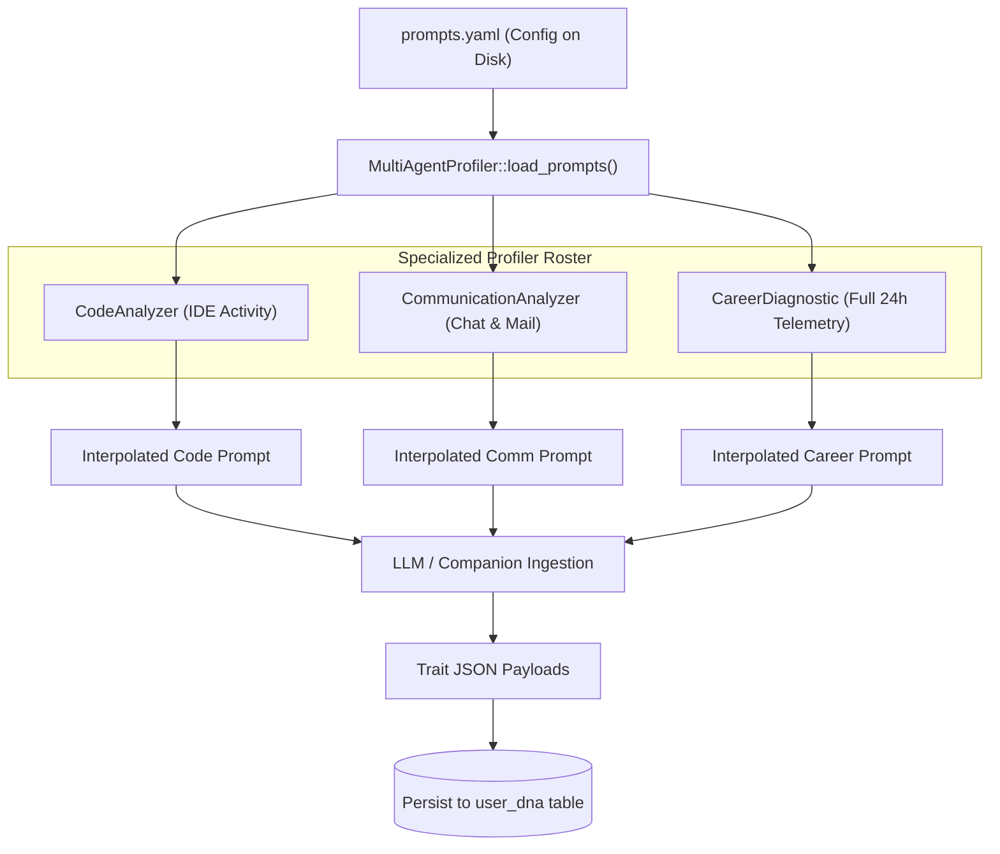

# 🔬 Engineering Deep-Dive 02: Hot-Reloadable Multi-Agent DNA Profiler

## 1. Modular Prompt Architecture Inspired by CrewAI

Hardcoding prompt strings inside compiled Rust binaries creates massive friction: every adjustment to an evaluation rubric or persona requires a full binary rebuild.

MyDNA implements a **Dynamic YAML Prompt Slicing Architecture** (`prompts.yaml`):
- **Slices:** Reusable prompt fragments (`role_playing`, `task_instruction`) with template interpolation variables (`{role}`, `{goal}`, `{backstory}`, `{logs}`).
- **Specialized Profiler Personas:**
  1. `CodeAnalyzer`: Senior Staff Engineer & Code Reviewer extracting coding habits and anti-patterns.
  2. `CommunicationAnalyzer`: HR & Communication Psychologist measuring tone, voice, and clarity in messaging apps.
  3. `CareerDiagnostic`: Tech Recruiter analyzing daily activity to infer job specialization and focus areas.



---

## 2. Dynamic Interpolation Engine (`user_profiler.rs`)

```rust
#[derive(Deserialize, Debug, Clone)]
pub struct PromptConfig {
    pub slices: HashMap<String, String>,
    pub agents: HashMap<String, AgentTemplate>,
}

pub fn build_agent_prompt(agent: &AgentType, logs: &str) -> String {
    let config = Self::load_prompts().expect("Failed to parse YAML");
    let agent_key = agent.as_str();
    let template = config.agents.get(agent_key).unwrap();

    let role_slice = config.slices.get("role_playing").unwrap();
    let task_slice = config.slices.get("task_instruction").unwrap();

    let interpolated_role = role_slice
        .replace("{role}", &template.role)
        .replace("{goal}", &template.goal)
        .replace("{backstory}", &template.backstory);

    let interpolated_task = task_slice.replace("{logs}", logs);

    format!("{}\n{}", interpolated_role, interpolated_task)
}
```

This design allows prompt engineers to tune evaluation guidelines on the fly without touching the core Rust daemon.
