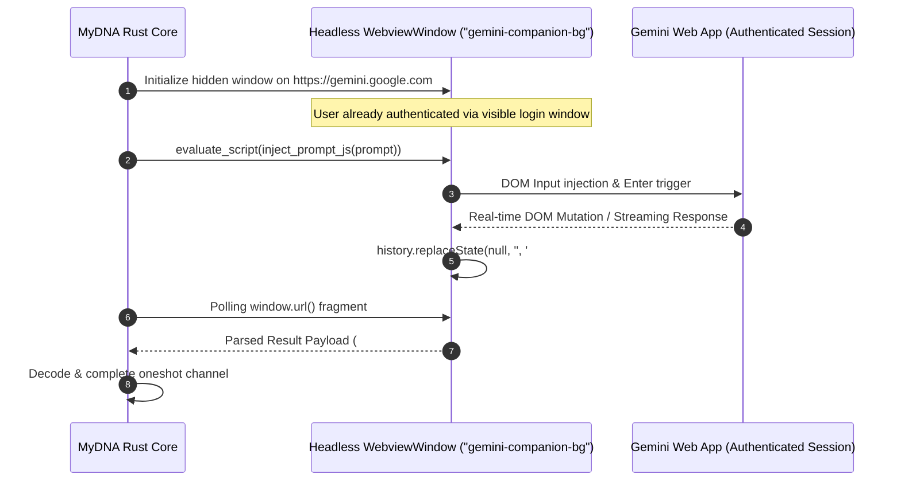

# 🔬 Engineering Deep-Dive 03: Headless WebView Companion vs Playwright Automation

## 1. The Headless Automation Dilemma

Automating interactions with browser-based AI models (such as Google Gemini) typically relies on headless browser automation libraries like Playwright, Puppeteer, or Selenium. However, in a desktop production daemon, this approach introduces fatal drawbacks:
1. **Bloated Bundles:** Bundling Chromium adds 150MB - 300MB to the application installer.
2. **High Memory Overhead:** Chromium child processes consume upwards of 350MB RAM even when idle.
3. **Bot Detection:** Cloudflare and Google BotGuard easily detect and challenge automated WebDriver sessions.

MyDNA completely eliminates external headless browsers by employing a **Native Tauri WebviewWindow Companion** reusing the operating system's native WebView2 engine.



---

## 2. Zero-Network IPC via URL Fragment Hashing

Cross-Origin Resource Sharing (CORS) and security policies prevent web scripts from freely POSTing arbitrary local HTTP endpoints from third-party origins like `gemini.google.com`.

MyDNA bypasses this limitation with zero network overhead using **URL Fragment Navigation State**:
- **Script Injection:** The Rust host injects an automation observer script into the WebView2 instance.
- **Fragment Protocol:** When results or chunks arrive, the script invokes:
  ```javascript
  history.replaceState(null, '', '#bzt-' + KIND + '-' + timestamp + '-' + encodeURIComponent(payload));
  ```
- **Rust Host Inspection:** The Tauri window loop monitors fragment changes, decodes the URI payload, and resolves asynchronous Tokio `oneshot::channel` futures with sub-millisecond latency.
