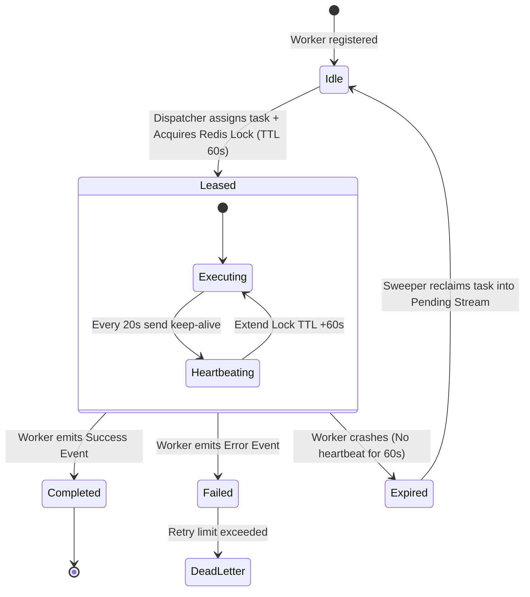
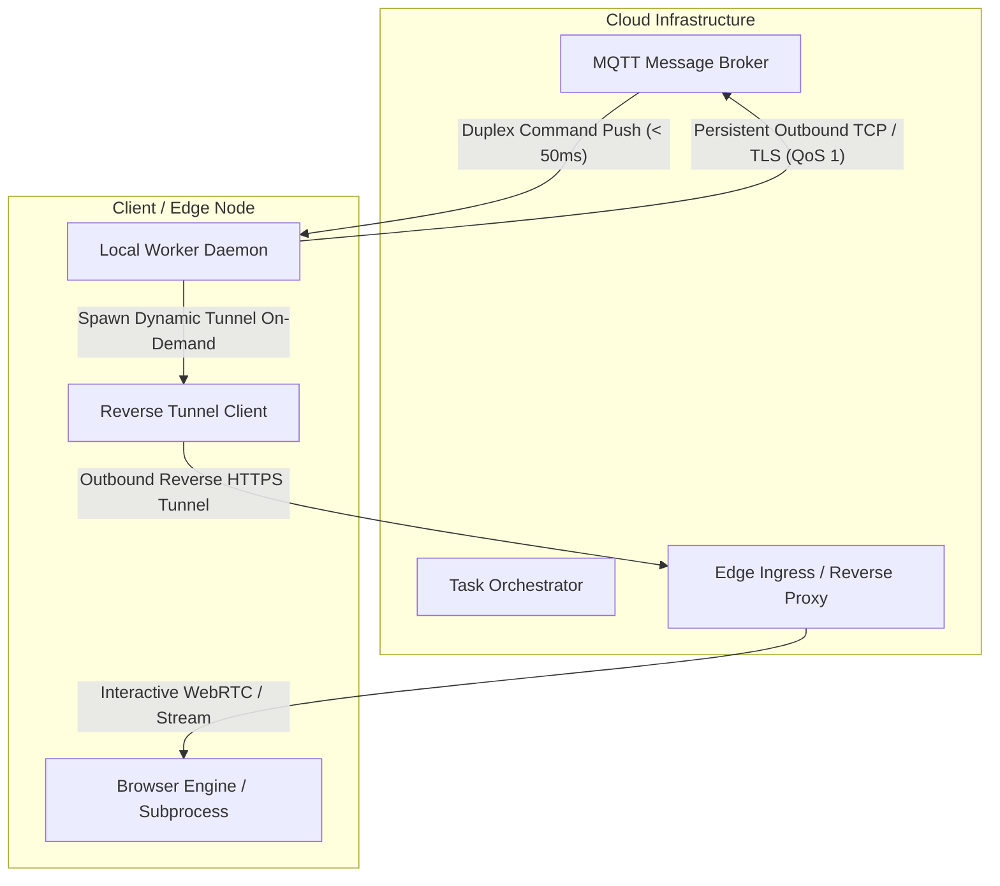

# ⚙️ Universal Distributed Systems Patterns

This document outlines key foundational patterns implemented across the case studies in this repository.

---

## 1. Distributed Worker Lease with TTL Heartbeat

In distributed computing where worker nodes execute long-running jobs (e.g. 5-30 minutes of browser automation), traditional short-timeout RPC is prone to failure. If a worker crashes midway, the job must not remain stranded indefinitely, nor should it be executed twice by another worker.

### State Diagram



### Invariants:
1. **Lock Owner Verification:** Heartbeat renewals and completion acknowledgments must always verify the unique worker ID token against the lock key (`EVAL` script in Redis) to prevent split-brain expiration races.
2. **At-Least-Once Delivery:** If a worker abruptly halts (kernel panic, power outage), the lease naturally expires after TTL, allowing the scheduler to safely re-assign the task.

---

## 2. Decoupled Dual-Channel Networking for Edge Nodes

When backend orchestrators need to interact with client nodes residing behind NATs (Network Address Translation) and strict firewalls:



### Key Advantages:
- **Zero Inbound Port Forwarding:** The worker initiates all connections outbound.
- **Resource Efficiency:** The high-bandwidth HTTP/WebSocket tunnel is activated **on-demand** only when visual debugging or real-time streaming is requested, keeping background idle bandwidth near zero.
- **Resilience:** If the dynamic tunnel resets, the control plane (MQTT) remains intact and immediately signals the orchestrator with the newly generated URL.

---

## 3. Idempotent Event Consumption with Redis Streams

To avoid duplicate processing during network retries, every dispatched task payload carries an immutable `idempotency_key`:

```
Payload:
{
  "task_id": "tsk_9f82a10b",
  "idempotency_key": "biz_882_action_batch_04",
  "payload": { ... },
  "dispatched_at": 1728810000
}
```

Consumers execute:
```lua
-- Atomic check-and-set idempotency gate
local exists = redis.call('SET', KEYS[1], ARGV[1], 'NX', 'EX', ARGV[2])
if exists then
    return 1 -- Proceed with processing
else
    return 0 -- Duplicate detected, ack and discard
end
```
